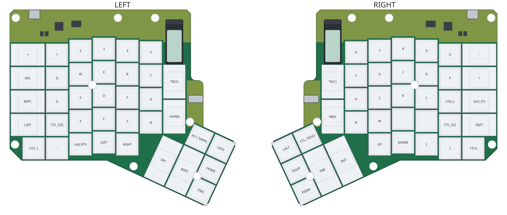
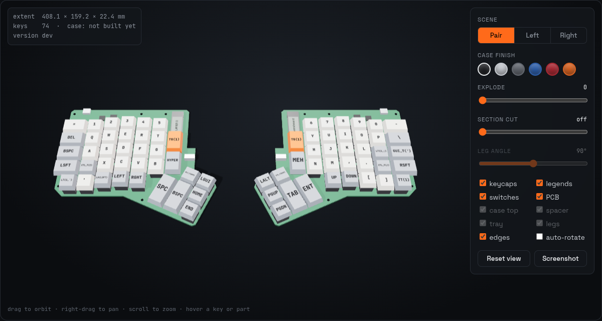
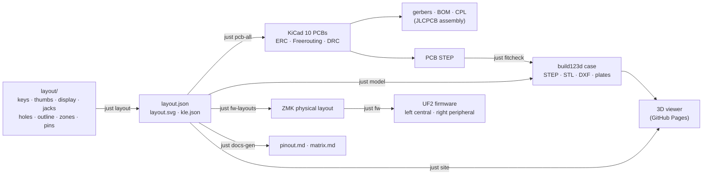

<div align="center">

# worxboard

**An ErgoDox EZ-style split keyboard with an on-board RP2040, ZMK wired split, a nice!view-class LCD
on each half and USB-C on both halves.**

[](https://github.com/w0rxbend/worxboard/actions/workflows/layout.yml)
[](https://zmk.dev)
[](https://www.kicad.org/)
[](https://github.com/gumyr/build123d)
[](LICENSE)
[](LICENSE-HARDWARE)

[Build guide](docs/buildguide_en.md) ·
[BOM](docs/bom.md) ·
[Firmware](docs/firmware.md) ·
[Ordering](docs/ordering-jlcpcb.md) ·
[Design spec](docs/design.md)



</div>

worxboard keeps the exact ErgoDox key positions and the 25° six-key thumb cluster. The top key of
the inner column on each half is replaced by a vertical memory LCD. The two halves link over TRRS
with ZMK's wired split. Everything is generated from one layout package ([`layout/`](layout/)): the
KiCad PCB, the build123d case, the ZMK physical layout, the docs tables and the 3D viewer.

> [!WARNING]
> **Status: rev A, in development. Nothing has been built yet.** The frozen design is
> [`docs/design.md`](docs/design.md); agreed deviations are in [`docs/deviations.md`](docs/deviations.md).
> Gates G1–G3 ([bom.md](docs/bom.md#gates)) block ordering.

| Part | State |
|---|---|
| Layout (`layout/`) | **Done.** Keys, thumbs, display, jacks, holes, outline, zones, GPIO map; tested by `just layout-check` |
| Firmware (`firmware/`, `zephyr/`, `build.yaml`) | **In progress.** ZMK module, 3-layer keymap, generated layouts, custom right screen and the firmware workflow are in; untested on hardware |
| PCB (`pcb/`) | **In progress.** Scripted KiCad 10 pipeline: schematic, placement, Freerouting, DRC, JLC files |
| Case and plates (`case/`, `plates/`) | **In progress.** build123d port of the ErgoDox CNC case |
| Docs and microsite (`docs/`, `site/`) | **First pass.** Build guide, BOM, electrical, generated pinout and matrix, viewer |

## Spin it in your browser

[](site/)

The microsite in [`site/`](site/) has a three.js viewer, adapted from the
[ErgoDox CNC case](https://github.com/w0rxbend/ergodox) viewer. It builds the PCB, switches, keycaps
(with legends) and displays of both halves straight from `layout/build/layout.json`, and adds the case
parts when the case model has been built. You can explode the stack, sweep a section plane, hover a
key to see its matrix position and GPIOs, and download the STLs. Build it with `just site`; the
`pages` workflow deploys it on demand.

## Features

- **Exact ErgoDox layout.** Switch centres, column stagger and the 25° thumb cluster come from the
  original ErgoDox PCB and are checked to 0.002 mm. 37 keys per half, 74 in total.
- **A display on each half.** A Sharp LS011B7DH03 memory LCD on a nice!view-compatible module sits
  where the inner top key was, behind a window in the case. The left shows the ZMK status screen,
  the right a custom screen with the lock indicators.
- **On-board RP2040, assembled by JLCPCB.** No controller daughterboard. The support circuit (flash,
  crystal, LDO, ESD) is cloned from the Corne v4.1 production BOM. Hot-swap sockets and diodes are
  assembled on the bottom side.
- **USB-C on both halves.** Plug the host into the **left** half. The right USB-C powers and flashes;
  Schottky diodes let both be plugged in at once.
- **A careful wired split.** ZMK `zmk,wired-split` on UART0 over a straight TRRS cable. The tip
  carries only 1 kΩ-limited data, power sits on Ring2 behind a 250 mA polyfuse, and a solder jumper
  (JP1) turns cable power off. **Never hot-plug the TRRS cable.**
- **One matrix netlist on both PCBs.** The right `.dts` reverses the column GPIOs, so the two boards
  share the same netlist and only the TRRS crossover differs.
- **Tent legs like the EZ.** Three mounts per half at the stock positions, taking the stock M3 spring
  thumbscrews ([legs.md](docs/legs.md)).
- **Generated, not drawn.** Schematic, placement, routing, DRC, fab files, case, physical layout and
  docs tables are all scripts, run headless in pinned containers.

| | |
|---|---|
| Keys | 74 (37 per half): 6 × 7 matrix per half, `col2row`, ZMK 6 × 14 transform |
| Controller | RP2040 + W25Q128 16 MB QSPI flash per half |
| Display | 160 × 68 Sharp memory LCD per half, PIO1 SPI |
| Split link | TRRS 3.5 mm, UART 115 200 baud, full duplex |
| USB | USB-C 2.0 full speed on both halves (host on the left) |
| PCB | 2 layers, 1.6 mm FR4, ENIG, about 183 × 159 mm per half |
| Switches | MX-compatible, Kailh hot-swap sockets; 2u plate-mount stabilisers on two thumb keys |
| Firmware | ZMK (HWMv2 board `worxbend/worxboard`), ZMK Studio on the left central |
| Case | Two-piece CNC aluminium (or printed) case with integrated plate, M2.5 screws, three tent legs per half |

## How it fits together



The stack from the bottom up (spec §10): the **bottom tray** (Z 0–7) with the hot-swap sockets and
diodes in its 4 mm cavity, the **PCB** (Z 7–8.6), the 3 mm **plate spacer**, and the **top shell**
with the 1.5 mm plate milled into its key well, the display window and pin holes over BOOT and RESET.

## Build from source

You need [uv](https://docs.astral.sh/uv/), [just](https://just.systems/) and Docker (for KiCad, the
ZMK toolchain and lychee).

```sh
just setup          # .venv with every Python group (Python 3.12)
just layout-check   # layout tests + no-diff check of the committed contracts
just fw             # ZMK firmware for every build.yaml row (Docker)
just pcb-all        # both PCBs: ERC, netlist check, routing, DRC, JLC files (Docker)
just model          # case STEP/STL/DXF and plates
just docs-check     # generated docs up to date + link check
just site           # microsite into _site/ (just site-serve serves it on :8000)
just all            # layout-check -> fw -> pcb-all -> model -> site
just --list         # every recipe
```

Recipes come from each area's own file: [`layout/layout.just`](layout/layout.just),
[`firmware/firmware.just`](firmware/firmware.just), [`pcb/pcb.just`](pcb/pcb.just),
[`case/case.just`](case/case.just) and [`site/site.just`](site/site.just).

## Repository layout

```
layout/              single source of truth; layout/build/layout.json is the committed contract
firmware/zmk/        ZMK board module (RP2040 worxboard, RP2350A worxboard2), keymap, custom screen
zephyr/module.yml    Zephyr module entry point (used by ZMK's build-user-config workflow)
build.yaml           ZMK build matrix
pcb/                 KiCad 10 projects per half, worxboard symbol/footprint library, generator scripts
case/                build123d case, drawings, fit check (exports/ is git-ignored)
plates/              plate DXFs
docs/                build guide, BOM, electrical, pinout, matrix, ordering, case, legs, firmware, spec
site/                microsite: web/ (three.js viewer), build_site.py, gen_docs.py
tools/               container helpers and pinned image digests
.github/workflows/   CI per area; pages.yml deploys the microsite (manual)
```

## Documentation

| Document | Contents |
|---|---|
| [docs/buildguide_en.md](docs/buildguide_en.md) | Build guide: parts, bare-board flashing, JP1 power modes, display socket, assembly |
| [docs/bom.md](docs/bom.md) | Bill of materials with LCSC numbers, [G3] flags, builder parts and the ordering gates |
| [docs/electrical.md](docs/electrical.md) | Power path, TRRS link, USB-C, MCU support circuit, display, PCB rules |
| [docs/pinout.md](docs/pinout.md) | RP2040 GPIO map, TRRS contacts, display header, anchors, holes (generated) |
| [docs/matrix.md](docs/matrix.md) | Key matrix per half, ZMK 6 × 14 transform, keymap order (generated) |
| [docs/firmware.md](docs/firmware.md) | ZMK builds, flashing, host behaviour, keymap, displays |
| [docs/ordering-jlcpcb.md](docs/ordering-jlcpcb.md) | Ordering assembled PCBs from JLCPCB, both sides |
| [docs/case.md](docs/case.md) | The case: Z stack, changes from the ErgoDox case, files, fasteners |
| [docs/legs.md](docs/legs.md) | Tent/tilt legs: mounts, positions, the custom leg |
| [docs/design.md](docs/design.md) | The frozen rev A specification |
| [docs/deviations.md](docs/deviations.md) | Agreed deviations from the specification |
| [docs/sources.md](docs/sources.md) | Prior art and attribution |

`docs/pinout.md` and `docs/matrix.md` are generated from `layout/build/layout.json` by
`site/gen_docs.py`; run `just docs-gen` after a layout change.

## License

- Code (`layout/`, `pcb/scripts/`, `case/*.py`, `firmware/`, `tools/`, `site/`): [GPL-3.0](LICENSE).
- Hardware (`pcb/` KiCad files and libraries, case geometry outputs, `plates/`, `docs/`):
  [CERN-OHL-S-2.0](LICENSE-HARDWARE). **Maintainer to confirm** this split before the first hardware tag.
- Third-party material: [`THIRD_PARTY.md`](THIRD_PARTY.md); attribution in [docs/sources.md](docs/sources.md).

The key and mounting-hole coordinates come from the original ErgoDox PCB by Fredrik Atmer and
contributors (GPL-3.0). "ErgoDox EZ" is a product of ZSA Technology Labs and "nice!view" of Nice
Keyboards; this project is not affiliated with or endorsed by either.
