<div align="center">

# worxboard

**An ErgoDox EZ-style split keyboard with an on-board RP2040, ZMK wired split, a nice!view-class LCD
on each half and USB-C on both halves. Every part of it is generated from one layout package.**

[](https://github.com/w0rxbend/worxboard/actions/workflows/layout.yml)
[](https://github.com/w0rxbend/worxboard/actions/workflows/firmware.yml)
[](https://github.com/w0rxbend/worxboard/actions/workflows/pcb.yml)
[](https://github.com/w0rxbend/worxboard/actions/workflows/case.yml)
<br>
[](https://zmk.dev)
[](https://www.kicad.org/)
[](https://github.com/gumyr/build123d)
[](LICENSE)
[](LICENSE-HARDWARE)

[Build guide](docs/buildguide_en.md) ·
[BOM](docs/bom.md) ·
[Firmware](docs/firmware.md) ·
[Ordering](docs/ordering-jlcpcb.md) ·
[Case](docs/case.md) ·
[Design spec](docs/design.md)

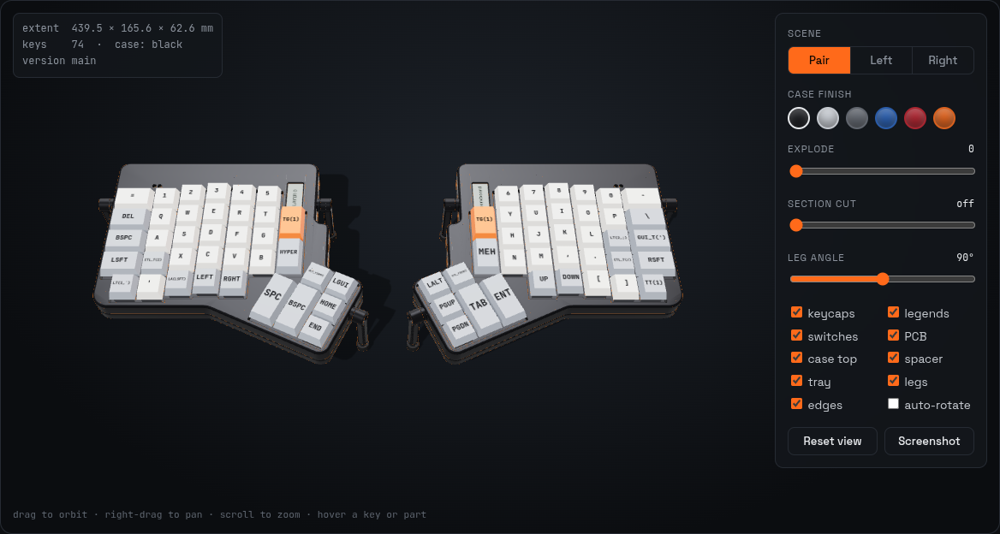

</div>

worxboard keeps the exact ErgoDox key positions and the 25° six-key thumb cluster. The top key of
the inner column on each half is replaced by a vertical memory LCD. The two halves link over TRRS
with ZMK's wired split. Everything is generated from one layout package ([`layout/`](layout/)): the
KiCad schematics and PCBs, the build123d case, the ZMK physical layout, the docs tables and the 3D
viewer. CI rebuilds all of it on every push.

> [!WARNING]
> **Status: rev A, designed and built in CI, not yet made.** The boards are routed and pass DRC,
> the firmware builds, the case fits the board STEPs, but no board has been ordered or tested on
> hardware. Gates **G1–G3** ([bom.md](docs/bom.md#gates)) are open and block ordering. The frozen
> design is [`docs/design.md`](docs/design.md); every change from it is in
> [`docs/deviations.md`](docs/deviations.md).

| Part | State |
|---|---|
| Layout (`layout/`) | **Done.** Keys, thumbs, display, jacks, holes, outline, zones and the GPIO map; `just layout-check` |
| PCB (`pcb/`) | **Routed.** Both halves generated in KiCad 10: ERC clean, DRC with schematic parity 0 violations / 0 unconnected, USB pair, crystal and outline checks pass. A seeded from-scratch rebuild reproduces the committed boards. CI writes gerbers, BOM, CPL, STEP and renders. |
| Firmware (`firmware/`, `zephyr/`, `build.yaml`) | **Builds.** All six `build.yaml` rows (left central, right peripheral, two role-swap and two RP2350A rows) build locally and in CI. Untested on hardware. |
| Case and plates (`case/`, `plates/`) | **Modelled.** Every case check passes; `just fitcheck` reports 0 mm³ against both PCB STEPs. Not printed or machined yet. |
| Docs and microsite (`docs/`, `site/`) | **Done.** Build guide, generated BOM, pinout and matrix, electrical, ordering, case, legs, firmware; the viewer |
| Gates and release | **Open.** G1–G3 to be verified; integration tests, `docs/verification.md` and the `v0.1.0-revA` tag are the last step (WS5) |

## Spin it in your browser

[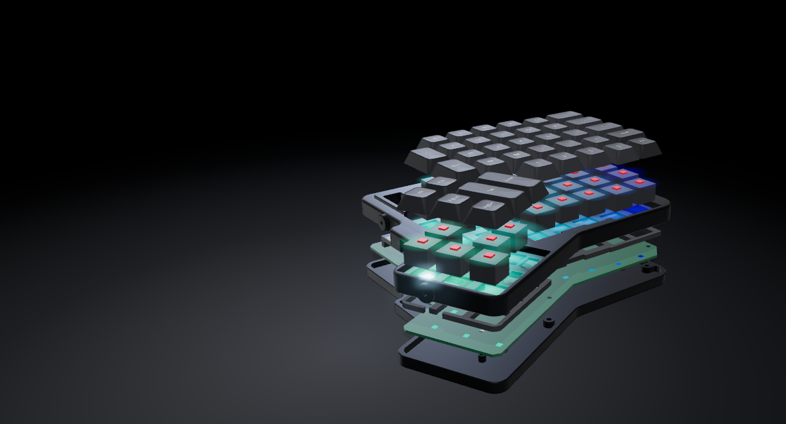](site/)

The microsite in [`site/`](site/) has a three.js viewer, adapted from the
[ErgoDox CNC case](https://github.com/w0rxbend/ergodox) viewer. It builds both halves straight from
`layout/build/layout.json`: PCB, switches, keycaps with legends and the displays. It places every
assembled part of the committed KiCad boards at its real position and adds the case STLs when the
case model has been built. You can explode the stack, sweep a section plane, swing the legs, hover a
key to see its matrix position, or a part to see its reference, and download the STLs. Build it
with `just site` and serve it with `just site-serve` (port 8000). The `pages` workflow deploys it to
GitHub Pages, on demand only; it has not been deployed yet.

## Features

- **Exact ErgoDox layout.** Switch centres, column stagger and the 25° thumb cluster come from the
  original ErgoDox PCB and are checked to 0.002 mm. 37 keys per half, 74 in total.
- **A display on each half.** A Sharp LS011B7DH03 memory LCD on a nice!view-compatible module sits
  where the inner top key was, behind a window in the case. The left shows the ZMK status screen,
  the right a custom screen with the lock indicators.
- **On-board RP2040, assembled by JLCPCB.** No controller daughterboard. The support circuit (flash,
  crystal, LDO, ESD) is cloned from the Corne v4.1 production BOM. The 37 hot-swap sockets and
  diodes per half are assembled on the bottom side.
- **USB-C on both halves.** Plug the host into the **left** half. The right USB-C powers and flashes;
  Schottky diodes let both be plugged in at once.
- **A careful wired split.** ZMK `zmk,wired-split` on UART0 over a straight TRRS cable. The tip
  carries only 1 kΩ-limited data, power sits on Ring2 behind a 250 mA polyfuse, and a solder jumper
  (JP1) turns cable power off. **Never hot-plug the TRRS cable.**
- **One matrix netlist on both PCBs.** The right `.dts` reverses the column GPIOs, so the two boards
  share the same netlist and only the TRRS crossover resistors differ.
- **Tent legs like the EZ.** Three mounts per half at the stock positions, taking the stock M3 spring
  thumbscrews ([legs.md](docs/legs.md)).
- **Generated, not drawn.** Schematic, placement, routing, DRC, fab files, case, physical layout and
  docs tables are all scripts, run headless in pinned containers. The PCB pipeline is seeded, so a
  rebuild gives byte-identical boards.

| | |
|---|---|
| Keys | 74 (37 per half): 6 × 7 matrix per half, `col2row`, ZMK 6 × 14 transform |
| Controller | RP2040 + W25Q128 16 MB QSPI flash per half |
| Display | 160 × 68 Sharp memory LCD per half, PIO1 SPI |
| Split link | TRRS 3.5 mm, UART 115 200 baud, full duplex |
| USB | USB-C 2.0 full speed on both halves (host on the left) |
| PCB | 2 layers, 1.6 mm FR4, ENIG, 182.8 × 158.8 mm per half; 118 JLC-assembled parts per half |
| Switches | MX-compatible, Kailh hot-swap sockets; 2u plate-mount stabilisers on two thumb keys |
| Firmware | ZMK (HWMv2 board `worxbend/worxboard`), ZMK Studio on the left central |
| Case | Two-piece CNC 6061 case with integrated plate, 192.4 × 165.6 × 17.6 mm and about 348 g per half; 8 × M2.5 screws and three tent legs per half |

## How it fits together

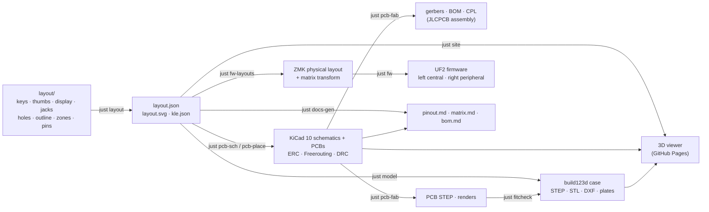

The stack from the bottom up (spec §10): the **bottom tray** (Z 0–7) with the hot-swap sockets and
diodes in its 4 mm cavity, the **PCB** (Z 7–8.6), the 3 mm **plate spacer**, and the **top shell**
with the 1.5 mm plate milled into its key well, the display window and pin holes over BOOT and RESET.

## Get the files

Every push to `main` rebuilds everything. Download the artifacts of a green run:

| Workflow | Artifact | Contents |
|---|---|---|
| [firmware](https://github.com/w0rxbend/worxboard/actions/workflows/firmware.yml) | `worxboard-firmware` | six `.uf2` files: `worxboard_left_central`, `worxboard_right_peripheral` and the `*_EXPERIMENTAL` rows ([firmware.md](docs/firmware.md)) |
| [pcb](https://github.com/w0rxbend/worxboard/actions/workflows/pcb.yml) | `worxboard-pcb-left`, `worxboard-pcb-right` | `gerbers.zip`, `bom.csv`, `pos.csv` for JLCPCB, the board STEP, the Edge.Cuts DXF, the DRC report, the renders ([ordering-jlcpcb.md](docs/ordering-jlcpcb.md)) |
| [pcb](https://github.com/w0rxbend/worxboard/actions/workflows/pcb.yml) | `worxboard-pcb-erc`, `worxboard-pcb-rebuild-*` | ERC reports and netlists; the from-scratch rebuilds and their Freerouting logs |
| [case](https://github.com/w0rxbend/worxboard/actions/workflows/case.yml) | `worxboard-case` | case STEP/STL/DXF, plates, renders, build report and the CNC order package with PDF drawings ([case.md](docs/case.md)) |

Tagged `v*-revA` releases with the same files are planned (WS5); no release exists yet.

## Previews

The committed boards, rendered by KiCad (`just pcb-fab <side>`):

| | Top | Bottom |
|---|---|---|
| Left | 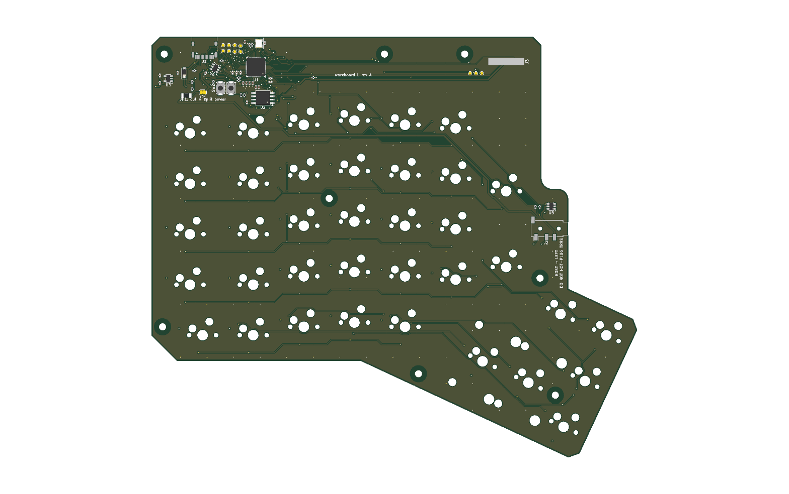 | 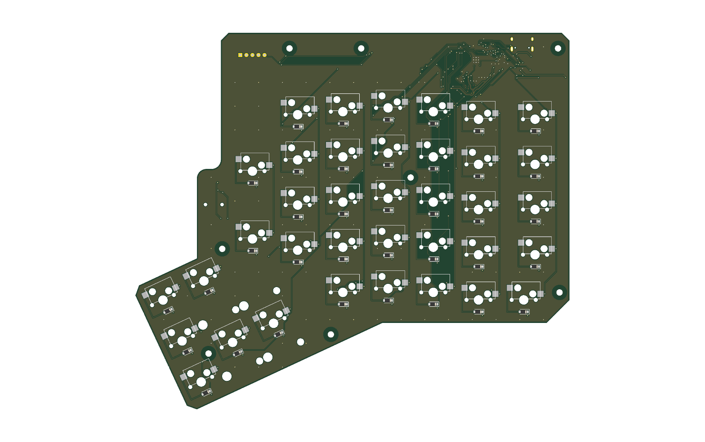 |
| Right | 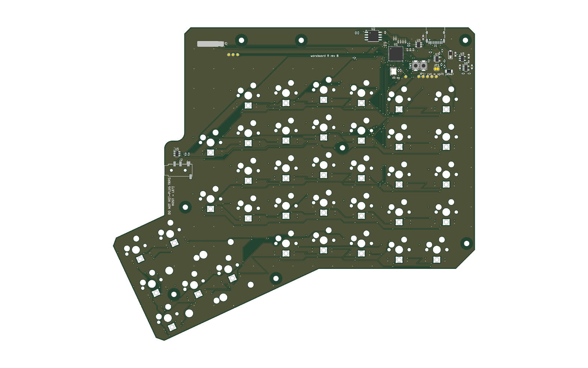 | 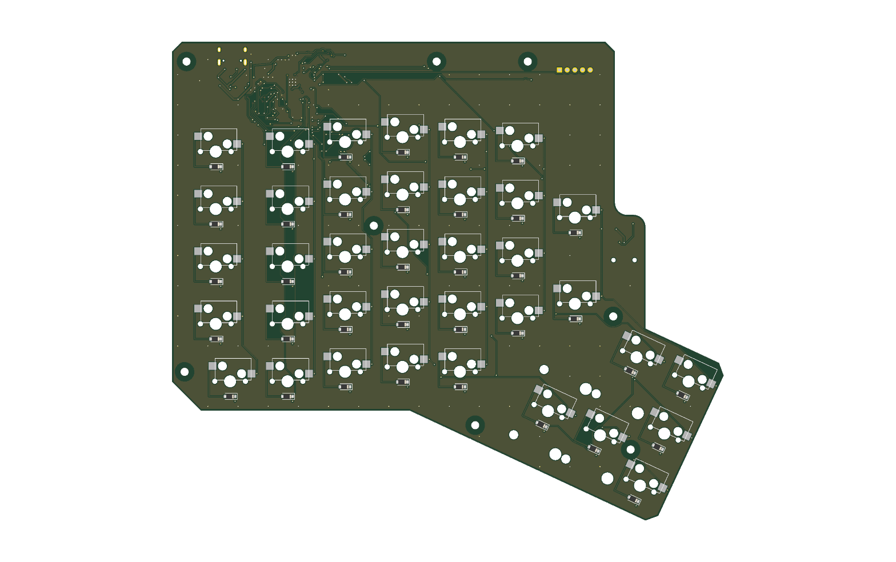 |

The case (`just renders`):

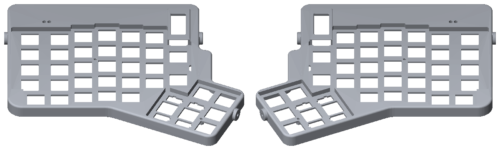

| Top shell, underside | Bottom tray |
|---|---|
| 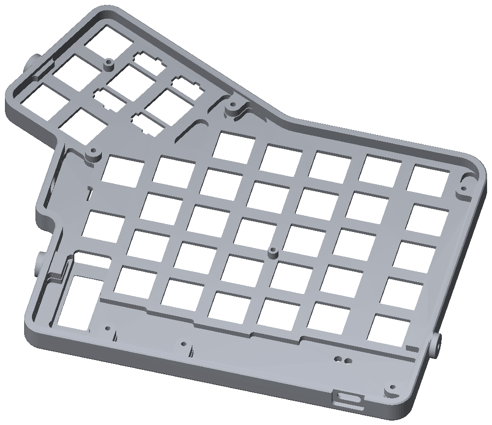 | 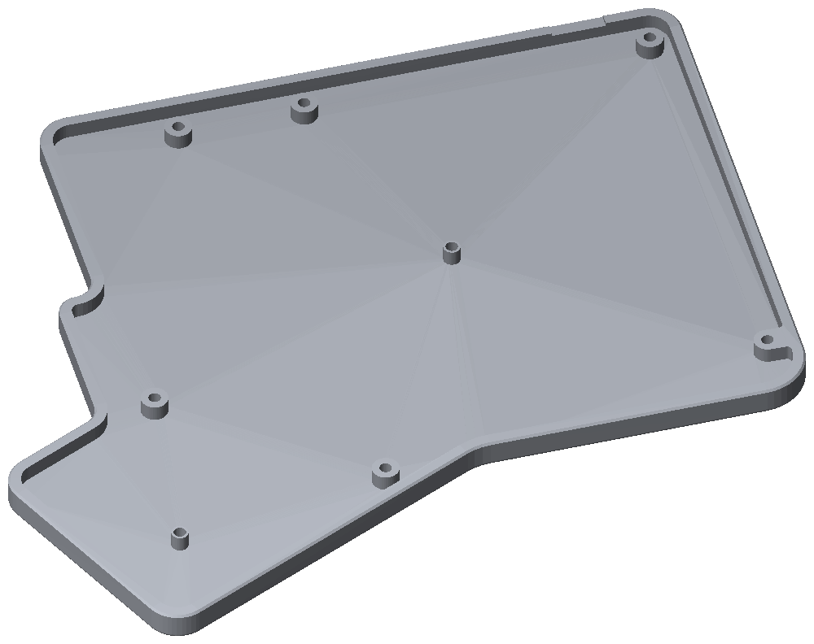 |

| Right half with the tent legs | Leg mount section |
|---|---|
| 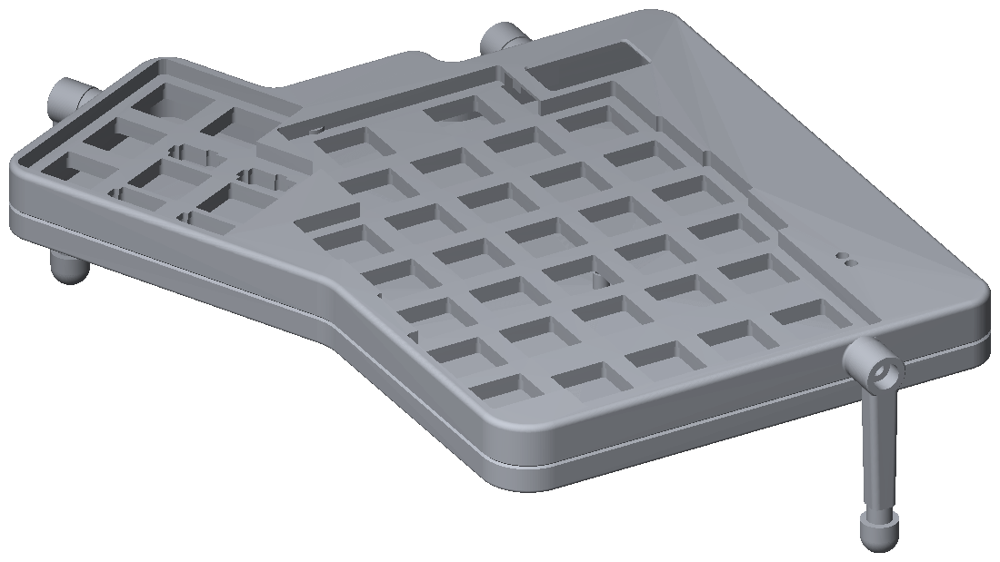 | 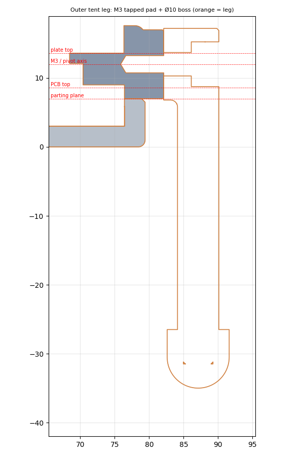 |

More in [docs/case.md](docs/case.md#previews), and the generated layout in
[docs/images/layout.svg](docs/images/layout.svg).

## Build from source

You need [uv](https://docs.astral.sh/uv/), [just](https://just.systems/) and Docker (for KiCad
10.0.7, Freerouting, the ZMK toolchain and lychee).

```sh
just setup          # .venv with every Python group (Python 3.12)
just layout-check   # layout tests + no-diff check of the committed contracts
just fw             # ZMK firmware for every build.yaml row -> build/fw/artifacts/*.uf2 (Docker)
just pcb-drc left   # DRC gate (schematic parity, 0 unconnected) + scripted checks on the committed board
just pcb-fab left   # JLC gerbers/BOM/CPL, renders, Edge DXF, STEP -> build/left/ (Docker, -full image)
just pcb-all        # both PCBs from scratch: schematic, placement, routing, DRC, fab (~20 min per side)
just model          # case STEP/STL/DXF -> case/exports/, plates/*.dxf
just fitcheck       # case vs build/<side>/worxboard-<side>.step: 0 mm3
just docs-check     # generated docs up to date + link check
just site           # microsite into _site/ (just site-serve serves it on :8000)
just all            # layout-check -> fw -> pcb-all -> model -> site
just --list         # every recipe
```

Recipes come from each area's own file: [`layout/layout.just`](layout/layout.just),
[`firmware/firmware.just`](firmware/firmware.just), [`pcb/pcb.just`](pcb/pcb.just),
[`case/case.just`](case/case.just) and [`site/site.just`](site/site.just). The PCB stages run in
`kicad/kicad:10.0.7` (`-full` for STEP and renders) with `--network none`; `just pcb-deps` installs
their pinned Python packages into `pcb/.tools/` once.

## Known open issues

- **Not built yet.** No board has been made; the displays, the wired split, the lock-indicator
  forwarding and the role-swap firmware are untested on hardware.
- **Gates G1–G3** ([bom.md](docs/bom.md#gates)): the display stack and active-area position, the
  TRRS jack height and pad map, every [G3] part, and the 0.127 mm track minimum. The case leaves only
  0.5 mm over a 5.5 mm jack body.
- **Display orientation.** The module is mounted upright, but both screens are laid out landscape;
  expect rotated text until the firmware gets a rotation ([firmware.md](docs/firmware.md#known-issues)).
- **Stock.** On 2026-10-29 LCSC listed no stock for the flash C113767, the 10 kΩ resistor C25744 and
  the hot-swap socket C2803348.
- **3D models.** KiCad has no model for the USB-C, the TRRS jack or the hot-swap socket, so the board
  STEP and the JLC preview lack those bodies; the STEP also leaves out the DNP display socket J3.
- **RP2350A target** (`worxboard2`): settings do not persist (flash map and NVS are forced off).
- **Licence split** (below) awaits the maintainer's confirmation.

## Repository layout

```
layout/              single source of truth; layout/build/layout.json is the committed contract
pcb/                 KiCad 10 projects per half (left/, right/), worxboard symbol/footprint library (lib/),
                     generator scripts (scripts/: design, schematic, placement, routing, checks, fab)
firmware/zmk/        ZMK board module (RP2040 worxboard, RP2350A worxboard2), keymap, custom screen, scripts
zephyr/module.yml    Zephyr module entry point for the ZMK build
build.yaml           ZMK build matrix
case/                build123d case, drawings, fit check, overlay, renders/ (exports/ is git-ignored)
plates/              plate DXFs
docs/                build guide, BOM, electrical, pinout, matrix, ordering, case, legs, firmware, spec
site/                microsite: web/ (three.js viewer), build_site.py, gen_docs.py, pcbdata.py
tools/               container helpers and pinned image digests
.github/workflows/   layout, firmware, pcb, case on every push; pages.yml deploys the microsite (manual)
```

## Documentation

| Document | Contents |
|---|---|
| [docs/buildguide_en.md](docs/buildguide_en.md) | Build guide: parts, bare-board flashing, JP1 power modes, display socket, assembly, troubleshooting |
| [docs/bom.md](docs/bom.md) | Bill of materials with LCSC numbers and [G3] flags (generated), builder parts, the ordering gates |
| [docs/electrical.md](docs/electrical.md) | Power path, TRRS link, USB-C, MCU support circuit, display, reference designators, PCB rules and pipeline |
| [docs/pinout.md](docs/pinout.md) | RP2040 GPIO map, TRRS contacts, display header, part positions, holes (generated) |
| [docs/matrix.md](docs/matrix.md) | Key matrix per half, sockets and diodes, ZMK 6 × 14 transform, keymap order (generated) |
| [docs/firmware.md](docs/firmware.md) | ZMK builds, flashing, host behaviour, keymap, displays, known issues |
| [docs/ordering-jlcpcb.md](docs/ordering-jlcpcb.md) | Ordering assembled PCBs from JLCPCB, both sides |
| [docs/case.md](docs/case.md) | The case: Z stack, changes from the ErgoDox case, files, fasteners, previews |
| [docs/legs.md](docs/legs.md) | Tent/tilt legs: mounts, positions, the custom leg |
| [docs/design.md](docs/design.md) | The frozen rev A specification |
| [docs/deviations.md](docs/deviations.md) | Every change from the specification, by work-stream |
| [docs/sources.md](docs/sources.md) | Prior art, tools and attribution |

`docs/pinout.md`, `docs/matrix.md` and the BOM tables in `docs/bom.md` are generated by
`site/gen_docs.py` from `layout/build/layout.json`, `pcb/scripts/design.py` and the committed
boards; run `just docs-gen` after a layout or PCB change (`just docs-check` fails if they are stale).

## License

- Code (`layout/`, `pcb/scripts/`, `case/*.py`, `firmware/`, `tools/`, `site/`): [GPL-3.0](LICENSE).
- Hardware (`pcb/` KiCad files and libraries, case geometry outputs, `plates/`, `docs/`):
  [CERN-OHL-S-2.0](LICENSE-HARDWARE). **Maintainer to confirm** this split before the first hardware tag.
- Third-party material: [`THIRD_PARTY.md`](THIRD_PARTY.md); attribution in [docs/sources.md](docs/sources.md).

The key and mounting-hole coordinates come from the original ErgoDox PCB by Fredrik Atmer and
contributors (GPL-3.0). "ErgoDox EZ" is a product of ZSA Technology Labs and "nice!view" of Nice
Keyboards; this project is not affiliated with or endorsed by either.
