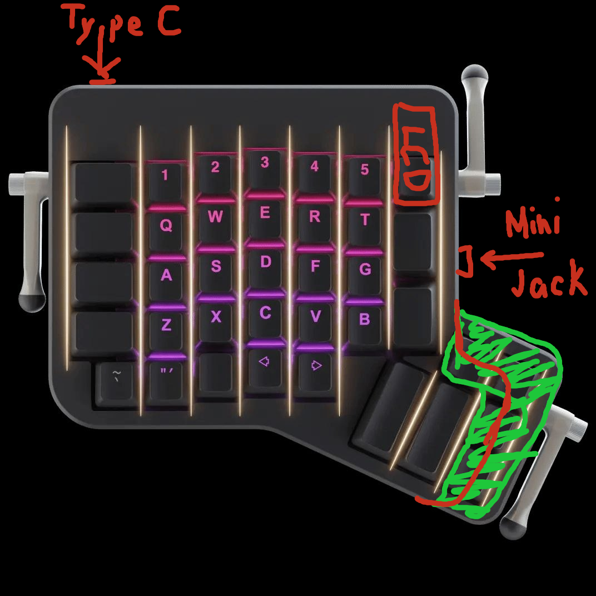

# worxboard

An ErgoDox EZ-style split keyboard with a custom RP2040 PCB, ZMK firmware,
a nice!view-class display on each half, USB-C on both halves and a TRRS link
between them. Work in progress: see the commit history.

