<div align="center">

# ⌨️ worxboard

**An ErgoDox-style split keyboard, generated from one layout package.**

On-board RP2040 · ZMK wired split · a memory LCD on each half · per-key RGB · USB-C on both halves · MX hot-swap, fully assembled at JLCPCB or PCBWay · CNC aluminium case

<sub>🚧 <b>rev B is designed on four layers and its gates passed locally on 2026-11-12. Order only from a commit with a green pcb workflow. Not built.</b></sub>

[](docs/verification.md#not-verified-until-a-board-is-built) [](https://github.com/w0rxbend/worxboard/actions/workflows/layout.yml) [](https://github.com/w0rxbend/worxboard/actions/workflows/firmware.yml) [](https://github.com/w0rxbend/worxboard/actions/workflows/pcb.yml) [](https://github.com/w0rxbend/worxboard/actions/workflows/case.yml)<br>
[](https://zmk.dev) [](https://www.kicad.org/) [](https://github.com/gumyr/build123d) [](LICENSE) [](LICENSE-HARDWARE)

**[🌐 Live 3D viewer](https://w0rxbend.github.io/worxboard/) · [🛒 Order it](#-order-it) · [🚀 Zero to typing](#-from-zero-to-typing) · [🔧 Build guide](docs/buildguide_en.md) · [📋 BOM](docs/bom.md) · [🧾 Shopping list](docs/shopping-list.md)**<br>**[💾 Firmware](docs/firmware.md) · [🧱 Case](docs/case.md) · [📐 Design spec](docs/design.md) · [🧪 Verification](docs/verification.md)**

<a href="docs/images/site-viewer.png"></a>

<sub>🖥️ Both halves in the browser 3D viewer, built from <a href="layout/build/layout.json">layout.json</a>: ErgoDox stagger, 25° thumbs, the display in the inner top slot, the tent legs. A render, not a photo, committed on 2026-11-02, before case revisions A3 to A5 and before rev B, so the case has no raised display bezel yet and the boards have no LEDs.</sub>

</div>

worxboard keeps the exact ErgoDox key positions and the 25° six-key thumb cluster. On each half, the top key of the inner column is replaced by a vertical memory LCD, an RGB LED sits under every switch, and the two halves link over TRRS with ZMK's wired split. Everything is generated from one layout package, [`layout/`](layout/): the KiCad schematics and PCBs, the build123d case, the ZMK physical layout, the docs tables and the 3D viewer. On every push to `main` and every pull request, CI rebuilds and checks the layout, the firmware, both PCBs with their order packages, and the case with its order package. The generated docs tables are checked by `just docs-check`, and the viewer is built by `just site`. Both also run in the manual `pages` workflow.

> [!WARNING]
> **Status: rev B passed its gates locally and in CI on 2026-11-12, and is tagged as the pre-release `v0.2.0-revB`; only the order-day stock check stays open.** Its PCBs moved to four layers (solid GND and VLED planes, scripted LED cells, the repo's own maze router; no Freerouting, [REVB-8](docs/deviations.md)), and the results of the final routed boards are in [verification.md](docs/verification.md#rev-b-results). Rev B puts an SK6812MINI-E RGB LED under every switch, moves the display 1.0 mm back from the C6R1 key well, folds in the pre-order review's minor points and adds a PCBWay order package beside the JLCPCB one ([deviations REVB-1 to REVB-9](docs/deviations.md#revb-rev-b-per-key-rgb-display-setback-and-review-fixes-layout-pcb-firmware-case-docs)). [verification.md](docs/verification.md) records rev A's gates **G1–G3** as passed and the rev B gates with their results. No board of either revision has been made, and nothing has been tested on hardware. Do not order assembled rev B boards until the `pcb` workflow is green on the commit you order from and the stock check has run. The frozen rev A design is [`docs/design.md`](docs/design.md), and every change from it is listed in [`docs/deviations.md`](docs/deviations.md). Read the [known open issues](#-known-open-issues) before you order.

| ⌨️ Keys | 🧠 MCU | 📟 Display | 🌈 RGB | 🔗 Split link | 🏭 Assembly | 🧱 Case |
|:-:|:-:|:-:|:-:|:-:|:-:|:-:|
| **74**, 37 per half | **RP2040** on each PCB | **160 × 68** memory LCD per half | **37** SK6812MINI-E per half, one under each switch | **115 200** baud UART over TRRS | **201** fab-assembled parts per half | **≈ 349 g** of 6061-T6 per half |

<details>
<summary>🚦 Status by part</summary>

| Part | State |
|---|---|
| 🧬 Layout (`layout/`) | ✅ **Done.** Keys, thumbs, display, LED positions and chain, jacks, holes, outline, zones and the GPIO map; checked by `just layout-check` |
| 🟩 PCB (`pcb/`) | ✅ **Designed (rev B, four layers). Gates passed locally and in CI; the stock check is open until the order day.** Both halves are generated in KiCad 10, with the per-key RGB chain, the VLED switch U6 and the data buffer U7, on F.Cu / GND plane / VLED plane / B.Cu. The gates of the final routed boards and their order packages in [`pcb/production/`](pcb/production/) are recorded in [verification.md](docs/verification.md#rev-b-results). The pipeline stops on an ERC error, a netlist mismatch (the RGB chain included), a DRC violation, an unconnected item or a parity issue, and on a failed scripted check: the USB pair, crystal, decoupling, U1 ground return and GND links, via-in-pad, J1 pin-in-paste, outline, and each LED in its switch window. |
| 💾 Firmware (`firmware/`, `zephyr/`, `build.yaml`) | 🔨 **Builds.** All six `build.yaml` rows build locally and in CI: left central, right peripheral, two role-swap rows and two RP2350A rows. Both screens are laid out portrait for the upright display. The LED chains run as ZMK underglow, capped at 8 % brightness. Nothing has run on hardware. |
| 🧱 Case and plates (`case/`, `plates/`) | ✅ **Orderable.** Every case check passes, and so does JLCCNC's internal-corner rule. `just fitcheck` reports 0 mm³ of interference against both PCB STEPs plus the layout envelopes. The JLCCNC / JLC3DP package for case revision A5 (with PCBWay notes) is committed in [`case/production/`](case/production/README.md). Nothing has been printed or machined. |
| 📚 Docs and microsite (`docs/`, `site/`) | ✅ **Done.** The turnkey ordering guides for JLCPCB and PCBWay, shopping list, build guide, generated BOM, pinout and matrix, and the electrical, case, legs and firmware docs. The site is a product page with the 3D viewer and a build guide rendered from these docs. |
| 🧪 Gates and release | ✅ **Rev A and rev B passed. Rev B is the pre-release `v0.2.0-revB`.** [`docs/verification.md`](docs/verification.md) records rev A's integration tests (111 passed), CI, order-package checks and gates G1–G3, and the rev B gate results of 2026-11-12. [`release.yml`](.github/workflows/release.yml) publishes the committed order packages, the firmware and the case files on a `v*` tag. The tag `v0.1.0-revA` points at the rev A commit, `v0.2.0-revB` at rev B. |
| 🛠️ Hardware | ⏳ **Not built.** What only a real board can confirm is [listed](docs/verification.md#not-verified-until-a-board-is-built). |

</details>

## 🧭 Contents

| 👀 See it | 🛠️ Make it | 📖 Know it |
|---|---|---|
| [📸 Gallery](#-gallery) | [🚀 From zero to typing](#-from-zero-to-typing) | [🤖 Generated, not drawn](#-generated-not-drawn) |
| [✨ Features](#-features) | [🛒 Order it](#-order-it) | [🐛 Known open issues](#-known-open-issues) |
| [📊 Specs](#-specs) | [🔧 Build it](#-build-it) | [🔭 Future work](#-future-work) |
| [📐 Layout and matrix](#-layout-and-matrix) | [💾 Firmware](#-firmware) | [🌳 Repository layout](#-repository-layout) |
| [🌐 Spin it in your browser](#-spin-it-in-your-browser) | [🧱 Case](#-case) | [📚 Documentation](#-documentation) |
| | [🧰 Build from source](#-build-from-source) | [🙏 Credits](#-credits) |
| | [📦 Get the files](#-get-the-files) | [📜 License](#-license) |

## 📸 Gallery

> [!NOTE]
> Every image in this README is a render, a CAD drawing or a screenshot. No photos exist yet, because no board has been built. The PCB renders and the CPL proofs were regenerated from the rev B boards on 2026-11-12, and the case renders show case revision A5. The two viewer images were captured from the microsite's 3D viewer on 2026-11-12: they show rev B in the case of revision A5, with the LEDs lit. KiCad has no 3D model for the USB-C, the TRRS jack or the hot-swap sockets, so the PCB renders show only their footprints.

<table>
<tr><td align="center" width="50%"><a href="docs/images/site-viewer-exploded.png"></a><br><sub>💥 Right half exploded in the viewer: tray, PCB, printed spacer, top shell, switches, keycaps</sub></td><td align="center" width="50%"><a href="case/renders/right_with_legs.png"></a><br><sub>🦵 Closed right-half case with its three custom tent legs (CAD render)</sub></td></tr>
<tr><td align="center"><a href="docs/images/pcb-left-top.png"></a><br><sub>🟩 Left PCB, top (rev B): RP2040, flash, USB-C J1, BOOT/RESET, JP1 (“cut = split power”), display socket J3, TRRS jack J2 on the inner bump</sub></td><td align="center"><a href="docs/images/pcb-right-top.png"></a><br><sub>🟩 Right PCB, top (rev B): mirrored, same netlist; both boards print DO NOT HOT-PLUG TRRS and HOST → LEFT by J2</sub></td></tr>
<tr><td align="center"><a href="docs/images/pcb-left-bottom.png"></a><br><sub>🟩 Left PCB, bottom (rev B): 37 hot-swap socket footprints and 37 diodes; rev B adds an LED and its cap at every key</sub></td><td align="center"><a href="docs/images/pcb-right-bottom.png"></a><br><sub>🟩 Right PCB, bottom (rev B): 37 socket footprints and 37 diodes, all fitted by the fab</sub></td></tr>
<tr><td align="center" colspan="2"><a href="case/renders/pair_top_iso.png"></a><br><sub>🧱 Both CNC top shells: the plate is milled into the key well, with 2u stabiliser cut-outs and a display window on each half</sub></td></tr>
</table>

## ✨ Features

<table>
<tr><td width="33%" valign="top">

**📐 Exact ErgoDox layout**<br>The switch centres, the column stagger and the 25° thumb cluster come from the original ErgoDox PCB. The thumb keys match it within 0.002 mm, and the main keys match the spec table within 0.0001 mm. 37 keys per half, 74 in total.

</td><td width="33%" valign="top">

**📟 A display on each half**<br>A Sharp LS011B7DH03 memory LCD (160 × 68) on a nice!view-class module sits where the inner top key was, behind a window in the case. The left half shows the ZMK status screen. The right half shows a custom lock-indicator screen.

</td><td width="33%" valign="top">

**🧠 On-board RP2040**<br>There is no controller daughterboard. The support circuit is derived from the [Corne v4.1](https://github.com/foostan/crkbd): QSPI flash, a 12 MHz crystal, an LDO and ESD arrays. JLCPCB or PCBWay fits all 201 parts per half, on both sides.

</td></tr>
<tr><td valign="top">

**🔌 USB-C on both halves**<br>Plug the host into the **left** half. The right USB-C gives power and UF2 flashing. Schottky diodes let you plug in both at once without back-feeding either host.

</td><td valign="top">

**🔗 A careful wired split**<br>ZMK `zmk,wired-split` runs on UART0 at 115 200 baud over a straight TRRS cable. The tip carries only 1 kΩ-limited data. Power sits on Ring2 behind a 250 mA polyfuse, and solder jumper JP1 turns cable power off.

</td><td valign="top">

**🔥 Hot-swap, no PCB soldering**<br>MX hot-swap sockets of the CPG151101S11 type sit on the bottom, with 2u plate-mount stabilisers on two thumb keys per half. The fab fits every PCB part, display socket and LEDs included; you solder only the displays' header pins (and any J1 shell leg that arrives bare).

</td></tr>
<tr><td valign="top">

**🧱 CNC aluminium case**<br>Each half has a 6061-T6 top shell with the 1.5 mm plate milled into it, a 6061-T6 tray and a printed 3 mm spacer. The finish is bead blast plus anodize. A raised bezel covers the display.

</td><td valign="top">

**🦵 Tent legs like the EZ**<br>Each half has three mounts at the stock ErgoDox EZ positions. Every mount takes one custom aluminium leg with a TPU foot cap, clamped by an M3 × 12 collarless thumbscrew and a friction washer.

</td><td valign="top">

**🤖 Generated, not drawn**<br>The schematic, placement, routing, DRC, fab files, case, physical layout and docs tables are all scripts. The PCB stages run headless in a digest-pinned KiCad container, with the repo's own router and seeded ids, so a rebuild gives byte-identical boards.

</td></tr>
<tr><td colspan="3" valign="top">

**🌈 Per-key RGB (rev B)**<br>An SK6812MINI-E sits under every switch, 37 per half, reverse-mounted in a cutout so it shines up through the switch's LED window on the south side (towards you); the fab places them with everything else. ZMK drives each half's chain as an underglow strip: whole-board effects (solid, breathe, spectrum, swirl), toggle, hue and brightness on the layer-1 thumbs, and the left half relays them to the right. There are no per-key or per-layer colours. A load switch keeps the LEDs unpowered until the firmware turns them on, and brightness is capped at 8 % so that one cable can feed both halves. None of it has run on hardware yet.

</td></tr>
</table>

## 📊 Specs

| Spec | rev B |
|---|---|
| ⌨️ **Keys** | 74 (37 per half). Each half has a 6 × 7 `col2row` matrix; ZMK sees one 6 × 14 transform |
| 🧠 **Controller** | RP2040 (QFN-56) per half, with W25Q128JVSIQ 16 MB QSPI flash and a 12 MHz crystal |
| 📟 **Display** | Sharp LS011B7DH03, 160 × 68 memory LCD on a nice!view-class module, driven over PIO1 SPI at 1 MHz. Rev B sets the module 1.0 mm back, so its far end stops about 0.2–0.3 mm short of the C6R1 key well (36 mm module plus its V-cut) |
| 🌈 **RGB** | 37 SK6812MINI-E per half, reverse-mounted on the bottom under each switch, facing south. One chain per half: GP22 through a buffer (U7) on PIO0; VLED switched from VSYS by U6 on GP23, limited to 0.45 A. ZMK underglow effects, brightness capped at 8 % |
| 🔗 **Split link** | 3.5 mm TRRS, ZMK wired split on UART0 at 115 200 baud, full duplex |
| 🔌 **USB** | USB-C 2.0 full speed on both halves (HRO TYPE-C-31-M-12); the host goes on the left |
| 🟩 **PCB** | 4 layers (signal, GND plane, VLED plane, signal), 1.6 mm FR4, 1 oz outer / 0.5 oz inner copper, ENIG, 182.84 × 158.75 mm per half. The fab places 201 parts per half: 53 on top, and 148 on the bottom (37 sockets, 37 diodes, 37 LEDs and their 37 caps) |
| 🎹 **Switches** | 74 MX-compatible plate-mount switches, 3- or 5-pin, in hot-swap sockets; 4 × 2u plate-mount stabilisers |
| 💾 **Firmware** | ZMK, HWMv2 board `worxbend/worxboard`, pinned at `4dd95d78`; ZMK Studio on the left central |
| 🧱 **Case** | 3 parts per half (CNC top and tray, printed spacer); 192.4 × 165.6 × 17.6 mm, 19.6 mm at the display bezel; about 349 g per half |
| 🦵 **Legs** | 3 per half, held by M3 × 12 DIN 653 thumbscrews with friction washers |

<details>
<summary>🔬 Full specs: key parts, power path, TRRS contacts, GPIO map</summary>

**🧩 Key parts per half** (the full generated table is in [docs/bom.md](docs/bom.md)):

| Ref | Part | LCSC | Ref | Part | LCSC |
|---|---|---|---|---|---|
| U1 | RP2040, QFN-56 | [C2040](https://jlcpcb.com/partdetail/C2040) | U2 | W25Q128JVSIQ, 16 MB QSPI flash | [C97521](https://jlcpcb.com/partdetail/C97521) |
| Y1 | 12 MHz 3225 crystal, YXC XL2EL89CRI-111YLC-12M | [C49304726](https://jlcpcb.com/partdetail/C49304726) | U3 | AP2112K-3.3, 600 mA LDO | [C51118](https://jlcpcb.com/partdetail/C51118) |
| U4, U5 | USBLC6-2SC6 ESD arrays (USB, TRRS) | [C7519](https://jlcpcb.com/partdetail/C7519) | D1 | B5819W, 1 A Schottky | [C8598](https://jlcpcb.com/partdetail/C8598) |
| F1 | nSMD025-24V PTC, 250 mA hold | [C70069](https://jlcpcb.com/partdetail/C70069) | J1 | HRO TYPE-C-31-M-12 USB-C receptacle | [C165948](https://jlcpcb.com/partdetail/C165948) |
| J2 | PJ-320D-4A TRRS jack, SMD | [C95562](https://jlcpcb.com/partdetail/C95562) | J3 | 1×5 2.54 mm female socket, 5.0 mm tall (the only through-hole part) | [C27985230](https://jlcpcb.com/partdetail/C27985230) |
| SW1, SW2 | TS-1088R tact switches (BOOT, RESET) | [C455280](https://jlcpcb.com/partdetail/C455280) | SK101–SK137 | MX hot-swap socket, HanElectricity CPG151101S11-16 | [C41430893](https://jlcpcb.com/partdetail/C41430893) |
| D101–D137 | 1N4148W matrix diodes | [C81598](https://jlcpcb.com/partdetail/C81598) | LED101–LED137 | SK6812MINI-E RGB LED, reverse mount (rev B) | [C5149201](https://jlcpcb.com/partdetail/C5149201) |
| U6 | SY6280AAC load switch, VSYS → VLED (rev B) | [C55136](https://jlcpcb.com/partdetail/C55136) | U7 | SN74LV1T34DBVR buffer, GP22 → LED101 (rev B) | [C100024](https://jlcpcb.com/partdetail/C100024) |
| C1–C3 | 10 µF 0603 10 V X5R (rev B; was 0402 6.3 V) | [C19702](https://jlcpcb.com/partdetail/C19702) |  |  |  |

`design.py` fits 201 parts per half with 26 LCSC numbers; each side's [order README](pcb/production/left/README.md) gives the BOM and CPL line counts. The retired parts C2803348 (socket), C113767 (flash), C91749 (crystal) and C15525 (rev A's 0402 10 µF) fail `stock.py` and `netcmp.py` if they come back.

**⚡ Power path**, the same on each half ([electrical.md](docs/electrical.md#power-path)):

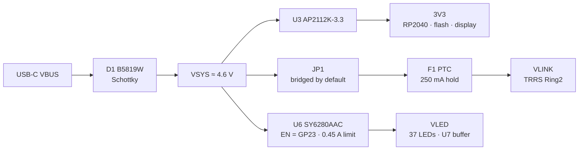

One cable is enough: the far half runs from VLINK at about 4.4 V from a 5 V host (a weak bus-powered hub leaves less; see [electrical.md](docs/electrical.md#per-key-rgb-rev-b)). Each VBUS reaches VSYS only through its own D1, so two hosts at once never back-feed each other. VBUS also reaches GP26 through a 10k/10k divider; the firmware does not use it yet. VLED stays off until the firmware drives GP23 (R15 pulls it low), and the 8 % brightness cap holds full white to about 107 mA per half (129 mA worst case) plus 22 mA for the dark LEDs and ~30 mA of logic: at most ~181 mA, about 72 % of the cable-fed right half's 250 mA (F1), and within the left port's 500 mA ([electrical.md](docs/electrical.md#per-key-rgb-rev-b)).

**🔗 TRRS contacts** ([electrical.md](docs/electrical.md#trrs-link)):

| Contact | Left PCB | Right PCB |
|---|---|---|
| Tip | `TRRS_A` = UART TX (GP0, via 1 kΩ) | `TRRS_A` = UART RX (GP1, via 1 kΩ) |
| Ring1 | `TRRS_B` = UART RX | `TRRS_B` = UART TX |
| Ring2 | VLINK | VLINK |
| Sleeve | GND | GND |

**📍 GPIO map**, identical on both PCBs (every pin is in [pinout.md](docs/pinout.md)):

| GPIO | Use |
|---|---|
| GP0 / GP1 | UART0 TX / RX, the wired split |
| GP2 / GP3 / GP5 | Display SCK / MOSI / CS (PIO1 SPI, CS active high) |
| GP8–GP13 | Matrix rows ROW0–ROW5 (inputs, pull-down) |
| GP14–GP20 | Matrix columns COL0–COL6 (outputs) |
| GP21 | TRRS detect test pad TP11 (not used by the firmware yet) |
| GP22 | RGB data: U7 buffer → LED101 … LED137 (PIO0, WS2812 driver; rev B) |
| GP23 | VLED enable: U6 EN, 10k pull-down (ZMK ext-power; rev B) |
| GP24 / GP25 | Spare test pads TP6 / TP7 |
| GP26 | VBUS sense through a 10k/10k divider (not used by the firmware yet) |
| SWCLK / SWDIO | SWD test pads TP8 / TP9, with GND on TP10 |

</details>

## 📐 Layout and matrix

<p align="center">
<a href="docs/images/layout.svg">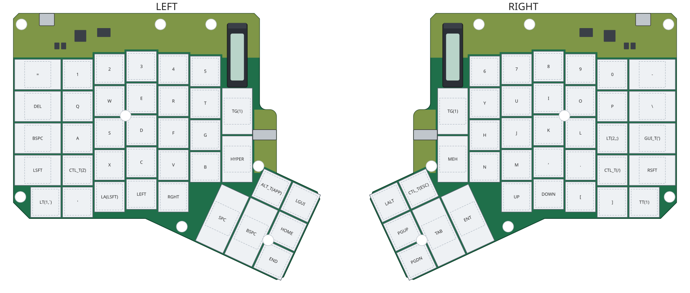</a><br><sub>🗺️ The generated layout (layout/export.py): ErgoDox stagger, 25° thumbs, the display in the C6R0 slot (at its rev B position), the jacks, the holes and the component zones. Click to open it full size.</sub>
</p>

On each half, the inner top key C6R0 is replaced by a vertical 14 × 36 mm display module. Rev B sets its bottom edge 1.0 mm behind the old C6R0 cell boundary, about 0.2–0.3 mm short of the C6R1 key well, so no key moves and the C6R1 keycap cannot reach the module at bottom-out ([REVB-2](docs/deviations.md#revb-2-the-display-moves-10-mm-back-from-the-c6r1-key-well-4-pre-order-review)). Each half has a 6 × 7 `col2row` matrix with rows on GP8–GP13 and columns on GP14–GP20. **Both PCBs share one matrix netlist**: the right `.dts` reverses `col-gpios` and sets `col-offset = <7>`, so the two netlists differ only in the TRRS TX/RX crossover at R11/R12.

| What changed from an ErgoDox EZ | worxboard rev B |
|---|---|
| 📟 Inner top key | Replaced by the display, so each half has 37 keys; the module sits 1.0 mm back from the C6R1 key well |
| 🌈 Lighting | An SK6812MINI-E under every switch, facing south, fitted by the fab. ZMK runs each half's chain as underglow: whole-board effects, not per-key colours |
| ✂️ Outline | Jack tabs removed, back edge straightened, a TRRS bump added on the inner edge |
| 🔩 Mounting hole #7 | Moved from under the display to (88.0, 37.135) |
| 🔌 Connectors | USB-C on both halves at the back edge; TRRS on the inner edge |
| 🧠 Controller | An on-board RP2040 per half |
| 💾 Firmware | ZMK, with the base layer taken from QMK `ergodox_ez` layer 0; the two inner-top functions (LEFT / RGHT) move to layer 1, and the RGB controls sit on the layer-1 thumb keys where the EZ has its RGB keys |
| 🎹 Switches | Kailh-type MX hot-swap sockets on the bottom |
| 🧱 Case | CNC 6061-T6. It drops the EZ's capacitor pocket, LED windows, reset hole and back-wall jack notches, and comes out about 1–2 mm smaller than the photo-measured EZ case |

> [!TIP]
> **🎹 What goes on top:** 74 MX-compatible plate-mount switches, 3- or 5-pin (Choc and Alps do not fit); for the LEDs, pick switches with an LED window or a clear housing, and shine-through keycaps if you want the light to show through the legends. Keycaps: 58 × 1u, 12 × 1.5u (8 horizontal in the outer columns, 4 vertical in the inner columns) and 4 × 2u vertical thumbs. **A standard 76-key ErgoDox keycap set covers it, with 2 × 1u spare.** Add 4 Cherry-style clip-in 2u plate-mount stabilisers for a 1.5 mm plate; screw-in PCB-mount stabilisers do not fit.

<details>
<summary>🧮 The ZMK 6 × 14 transform and the three layers</summary>

This is the global map that the keymap and ZMK Studio see. Left columns 0–6 are physical C0–C6, and right columns 7–13 are physical C6–C0 ([matrix.md](docs/matrix.md)).

**Left half** (global columns 0–6 = physical C0–C6)

| Row | 0 | 1 | 2 | 3 | 4 | 5 | 6 |
|---|---|---|---|---|---|---|---|
| 0 | `=` | `1` | `2` | `3` | `4` | `5` | 📟 LCD |
| 1 | `DEL` | `Q` | `W` | `E` | `R` | `T` | `TG(1)` |
| 2 | `BSPC` | `A` | `S` | `D` | `F` | `G` | · |
| 3 | `LSFT` | `CTL_T(Z)` | `X` | `C` | `V` | `B` | `HYPER` |
| 4 | `` LT(1,`) `` | `'` | `LA(LSFT)` | `LEFT` | `RGHT` | · | · |
| 5 | · | `SPC` | `BSPC` | `END` | `HOME` | `ALT_T(APP)` | `LGUI` |

**Right half** (global columns 7–13 = physical C6–C0)

| Row | 7 | 8 | 9 | 10 | 11 | 12 | 13 |
|---|---|---|---|---|---|---|---|
| 0 | 📟 LCD | `6` | `7` | `8` | `9` | `0` | `-` |
| 1 | `TG(1)` | `Y` | `U` | `I` | `O` | `P` | `\` |
| 2 | · | `H` | `J` | `K` | `L` | `LT(2,;)` | `GUI_T(')` |
| 3 | `MEH` | `N` | `M` | `,` | `.` | `CTL_T(/)` | `RSFT` |
| 4 | · | · | `UP` | `DOWN` | `[` | `]` | `TT(1)` |
| 5 | `LALT` | `CTL_T(ESC)` | `PGUP` | `PGDN` | `TAB` | `ENT` | · |

| Layer | Contents |
|---|---|
| 0 Base | The QMK `ergodox_ez` default layer 0 |
| 1 Sym | F1–F12, symbols, a right-hand numpad, and LEFT / RIGHT on the inner 1.5u `HYPER` / `MEH` keys |
| 2 Media | Mouse movement and clicks, media keys, `&bootloader`, `&sys_reset` and `&studio_unlock` |

Each layer has 74 bindings, in the order 12 / 14 / 12 / 14 / 10 and then the 12 thumb keys.

</details>

## 🌐 Spin it in your browser

> [!NOTE]
> **Live at [w0rxbend.github.io/worxboard](https://w0rxbend.github.io/worxboard/).** The manual [`pages`](.github/workflows/pages.yml) workflow deploys it from `main`, so the site shows `main` as of its last run. Run it locally with `just site-serve` (port 8000). GitHub also opens the committed STLs, such as [`worxboard_left_spacer.stl`](case/production/jlc3dp/worxboard_left_spacer.stl), in its own 3D viewer.

The microsite in [`site/`](site/) is a product page and a build guide. The product page opens with a scroll-driven tour of the keyboard in a three.js viewer (the hero shot and the exploded view above were captured from it): the aluminium case, the lights, the display, the exploded stack and the tent legs. The viewer was adapted from the [ErgoDox CNC case](https://github.com/w0rxbend/ergodox) viewer. It builds both halves straight from `layout/build/layout.json`: the PCB, switches, keycaps with legends, the LEDs and the displays. It places every assembled part of the committed KiCad boards at its real position, and it adds the case STLs if `just model` ran before `just site`.

The build guide is one page per step: ordering at JLCPCB, ordering at PCBWay, soldering at home, the shopping list, the case orders, assembly and firmware. `site/build_site.py` renders those pages from the Markdown files in `docs/` and `case/production/`, so the site and the repository cannot drift apart, and the build fails on a broken anchor between two guide pages.

The "Explore" section of the product page is the free viewer:

| Feature | What it does |
|---|---|
| 🎬 **Scenes** | Pair / Left / Right, plus six case finishes, each with its keycap set: Black, Silver, Space grey, Blue, Red, Orange |
| 🌈 **Light** | The four ZMK underglow effects (solid, breathe, spectrum, swirl), brightness and colour. A render, not a measurement of the real LEDs |
| 🎥 **Camera** | Iso, Top, Front and Side presets, full screen, slow turn |
| 💥 **Explode, cut, swing** | Pull the stack apart (tray, PCB, spacer, top shell, switches, keycaps), sweep a section plane along Y, swing the three tent legs per half from 0° to 180° |
| 🖱️ **Hover** | Shows a key's legend and ZMK matrix position, or a part's reference, value and footprint |
| 📥 **Downloads** | The case STLs and `layout.json`; a Save image button; deep links such as `#scene=left&finish=silver&view=top` |

Below the viewer, the page carries the specs, the build steps with links into the guide, the status of the design, a filterable gallery of every render and placement proof, and the documentation index. It states that the project is free and open source and names both licences.

## 🚀 From zero to typing

> [!TIP]
> Follow the steps in this order. Rev B has not been built, so one assembled PCB is flashed and tested before any aluminium is machined.

| Step | What you do | Docs and files |
|---|---|---|
| 1️⃣ 🟩 **Order the PCBs** | Two designs at JLCPCB or PCBWay: 5 PCBs each, 2 assembled, both sides. | 📄 [ordering-jlcpcb.md](docs/ordering-jlcpcb.md), [ordering-pcbway.md](docs/ordering-pcbway.md), [placement checklist](docs/ordering-jlcpcb.md#placement-preview-checklist)<br>📂 [`pcb/production/left/`](pcb/production/left/README.md), [`pcb/production/right/`](pcb/production/right/README.md) |
| 2️⃣ 🛍️ **Buy the parts** | 74 MX switches (with an LED window for the RGB), keycaps, 4 stabilisers, 2 nice!view, cables, case hardware. | 📄 [shopping-list.md](docs/shopping-list.md)<br>📂 [`case/production/hardware.csv`](case/production/hardware.csv) |
| 3️⃣ ⚡ **Flash and test the bare boards** | Flash both UF2s, test every socket with tweezers, check that all 37 LEDs per half light, set JP1, fit the displays. | 📄 [build guide §1–4](docs/buildguide_en.md#1-check-the-assembled-pcbs), [firmware.md](docs/firmware.md#flash)<br>📦 the `worxboard-firmware` artifact of a green [firmware run](https://github.com/w0rxbend/worxboard/actions/workflows/firmware.yml) |
| 4️⃣ 🧱 **Order the case** | Print a test top, then order from JLCCNC and JLC3DP. | 📄 [case.md](docs/case.md#before-machining), [build guide §5](docs/buildguide_en.md#5-prepare-the-case)<br>📂 [`jlccnc/`](case/production/jlccnc/ORDER_NOTES.md), [`jlc3dp/`](case/production/jlc3dp/ORDER_NOTES.md) |
| 5️⃣ 🔩 **Assemble** | Stabilisers into the top shell first, then PCB, spacer, top shell and screws; then switches, caps and legs. | 📄 [build guide §6–8](docs/buildguide_en.md#6-assemble-the-case), [legs.md](docs/legs.md) |
| 6️⃣ ⌨️ **Type** | TRRS in while both halves are unpowered, host into the **left** half, remap in ZMK Studio. | 📄 [build guide §9](docs/buildguide_en.md#9-connect-and-use), [keymap](docs/firmware.md#keymap) |

## 🛒 Order it

Every order file for one keyboard is committed, and CI rebuilds and checks the PCB and case packages on every push:

| Order | Where | Files | How |
|---|---|---|---|
| 🟩 Left and right PCBs, fully assembled (2 designs: 5 PCBs each, 2 of them assembled) | [JLCPCB](https://jlcpcb.com), Standard PCBA, both sides | [`pcb/production/left/`](pcb/production/left/README.md), [`pcb/production/right/`](pcb/production/right/README.md): `gerbers.zip`, `bom.csv`, `cpl.csv` | [ordering-jlcpcb.md](docs/ordering-jlcpcb.md) |
| 🟩 *or* the same two PCBs, turnkey | [PCBWay](https://www.pcbway.com), both sides | the same `gerbers.zip`, plus `pcbway/bom.csv` and `pcbway/centroid-panel.csv` in each side's folder | [ordering-pcbway.md](docs/ordering-pcbway.md) |
| 🧱 2 top shells, 2 bottom trays, 6 tent legs (6061-T6, bead blast + anodize, Strict tier if the form offers it) | [JLCCNC](https://jlccnc.com) | [`case/production/jlccnc/`](case/production/jlccnc/ORDER_NOTES.md) | the order notes |
| 🖨️ 1 tree of 8 leg foot caps (TPU 95A); the 2 plate spacers (MJF PA12) are optional and not in the first order | [JLC3DP](https://jlc3dp.com) | [`case/production/jlc3dp/`](case/production/jlc3dp/ORDER_NOTES.md) | the order notes |
| 🎹 Switches, keycaps, stabilisers, 2 nice!view displays, cables; 🔩 screws, feet, thumbscrews, washers | keyboard and hardware shops | [`case/production/hardware.csv`](case/production/hardware.csv) (the case hardware) | [shopping-list.md](docs/shopping-list.md) |

Either fab fits every part on the PCB, both sides: the 37 LEDs and their caps go on the bottom with the sockets and diodes. That includes the display socket J3, which is hand-soldered, and J1's shell legs, which are pin-in-paste. You only solder the displays' own header pins. The build guide still asks you to check that all four J1 shell-leg slots show solder, and to solder any bare leg yourself ([step 1](docs/buildguide_en.md#1-check-the-assembled-pcbs)).

> [!WARNING]
> **Never upload the JLC `cpl.csv` (or `bom.csv`) to PCBWay.** The JLC CPL carries JLC-only rotation and centre corrections and JLC's bottom-side convention; at PCBWay it misplaces the sockets by 3.9 mm and J3 by 5.1 mm and turns U2–U5. PCBWay gets its own files from `pcb/production/<side>/pcbway/` ([ordering-pcbway.md](docs/ordering-pcbway.md)).

> [!IMPORTANT]
> **💰 Cost.** Rev A's JLCPCB order of both halves, 2 assembled each, was estimated at **about \$307–425** on 2026-11-04, shipping included, before import duty and VAT. Rev B costs more: a four-layer board, 82 more parts per half to buy and place (the 74 LEDs and caps on the bottom, 8 on top) and five more part numbers to load. It has not been re-estimated: read the cost from your quote ([cost estimate](docs/ordering-jlcpcb.md#cost-estimate)). PCBWay quotes the parts after review. JLCCNC and JLC3DP quote the case when you upload the files.
>
> **📦 Stock moves daily.** Run `just pcb-stock left 5` on the day you order. Then order 2 assembled boards per side, test them, and only then order the aluminium case.

> [!CAUTION]
> **🔌 The cables.** Ordinary plugs fit: the case openings are U-slots (case revision A5, CASE-10).
> - **USB-C:** a USB 2.0 data cable (not charge-only). The slot takes an overmould up to 13 × 8 mm.
> - **TRRS:** 3.5 mm, **4-pole**, wired straight 1:1 (the crossover is on the PCB). The slot takes a plug body up to Ø8 mm.

<details>
<summary>🧾 The JLCPCB form at a glance, and what is in each order package (PCBWay: see its guide)</summary>

| PCB | PCBA |
|---|---|
| FR-4, 4 layers (default stack-up JLC04161H-7628, 0.5 oz inner copper), qty 5, Panel by Customer | Standard (Economic places one side only), both sides, qty 2 |
| 1.6 mm, ENIG, 1 oz, tented vias | Tooling holes and rails: Added by Customer; Confirm parts placement: Yes |

Do it once for the left side and once for the right, so the cart holds two designs, and paste the remark from each side's README into the order. The remark also answers JLC's likely question about the two pairs of stabiliser holes, 0.28 mm apart (deviation ORDER-3), so it doesn't hold the order. Every field is in [ordering-jlcpcb.md](docs/ordering-jlcpcb.md#step-by-step).

- **`pcb/production/<side>/`**: `gerbers.zip` (the panel: the board in a frame with rails, mouse-bite tabs, fiducials and tooling holes), `bom.csv` (LCSC numbers), `cpl.csv` (every placement, both sides, JLC rotation and centre corrections applied), `README.md` (the order form, the remark, the panel facts and the BOM and CPL counts), `worxboard-<side>-jlc-order.zip` (the same files plus that README), `bare-board/` (a 182.84 × 158.75 mm fallback in case the fab refuses the panel) and `pcbway/` (the PCBWay BOM with manufacturer part numbers, KiCad-native centroids for the panel and the bare board, and a README with the PCBWay form and remark).
- **`case/production/`** (case revision A5): `jlccnc/` (STEP + PDF drawings for the left and right tops, the left and right bottoms and the leg, plus `hole_table.csv` and `ORDER_NOTES.md`), `jlc3dp/` (`worxboard_leg_cap_tree.stl`, the optional `worxboard_{left,right}_spacer.stl`, `ORDER_NOTES.md`), `pcbway/ORDER_NOTES.md`, `hardware.csv` and the package [README](case/production/README.md). CI fails if any of it drifts from the model.

</details>

<details>
<summary>🎯 JLC placement proofs: one drawing per part type over the KiCad pads</summary>

`cpl_check.py` places JLC's own EasyEDA footprint for each CPL row and compares it with the KiCad pads, and the pipeline stops if one placement fails; the pass count per half is in each side's [order README](pcb/production/left/README.md) and in [verification.md](docs/verification.md). The reverse-mount LEDs are gated at 55 % of each terminal on its pad, because JLC's leads start over the cutout (REVB-1). Legend: grey is KiCad copper, white the holes, red JLC's pads, blue the part's terminals, green its body and gold the board edge. A red ring marks JLC pin 1, and a cross marks KiCad pad 1. JLC does not document its bottom-side convention. The tell is the bottom parts at angles other than 0° and 180°, which are the thumb parts; the side README lists them with their angles ([checklist](docs/ordering-jlcpcb.md#placement-preview-checklist)). **The drawings below are rev A's**: the rev B part types (the LEDs, the 0603 capacitors, U6 and U7) get theirs when the boards are regenerated. Redraw the proofs with `just pcb-cpl-images`.

<table>
<tr><td align="center" width="50%"><a href="docs/images/cpl-sk-hotswap-socket.svg">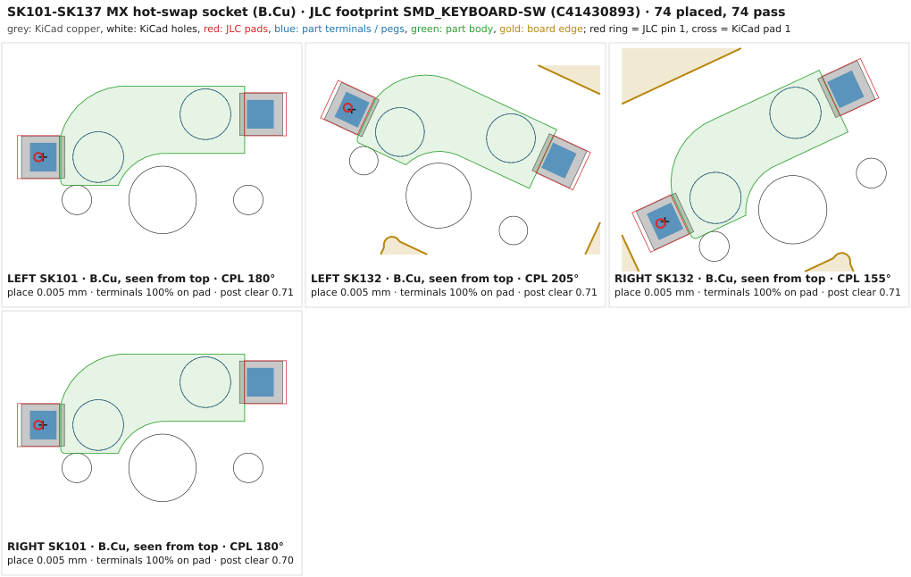</a><br><sub>Hot-swap sockets, bottom: 74 placed, 74 pass</sub></td><td align="center" width="50%"><a href="docs/images/cpl-d101-diode-sod123f.svg">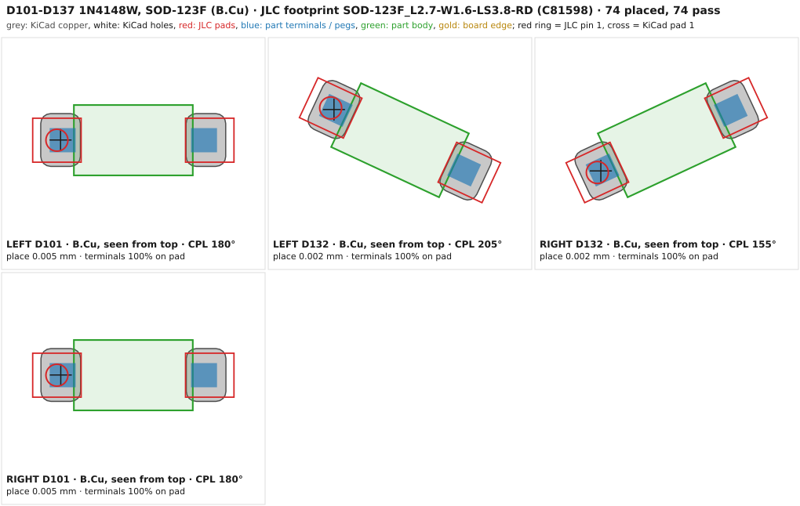</a><br><sub>Matrix diodes, bottom: 74 placed, 74 pass</sub></td></tr>
<tr><td align="center"><a href="docs/images/cpl-u1-rp2040-qfn56.svg">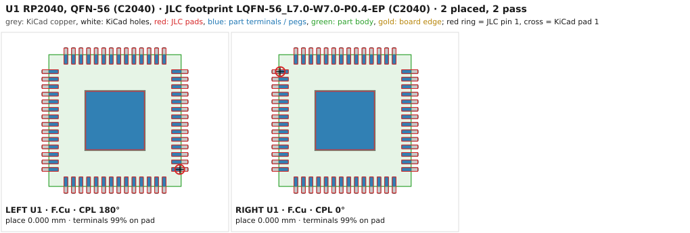</a><br><sub>U1 RP2040, QFN-56: both halves pass</sub></td><td align="center"><a href="docs/images/cpl-u2-flash-soic8.svg">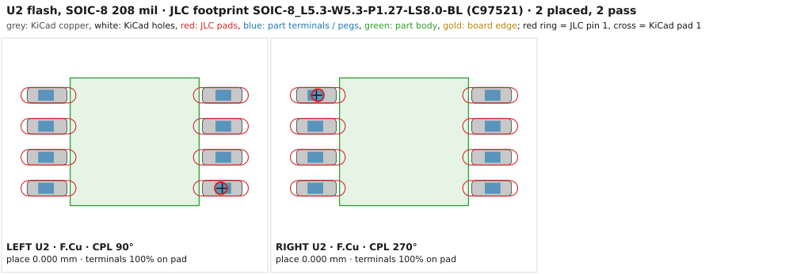</a><br><sub>U2 QSPI flash, SOIC-8: both halves pass</sub></td></tr>
<tr><td align="center"><a href="docs/images/cpl-u3-ldo-sot23-5.svg">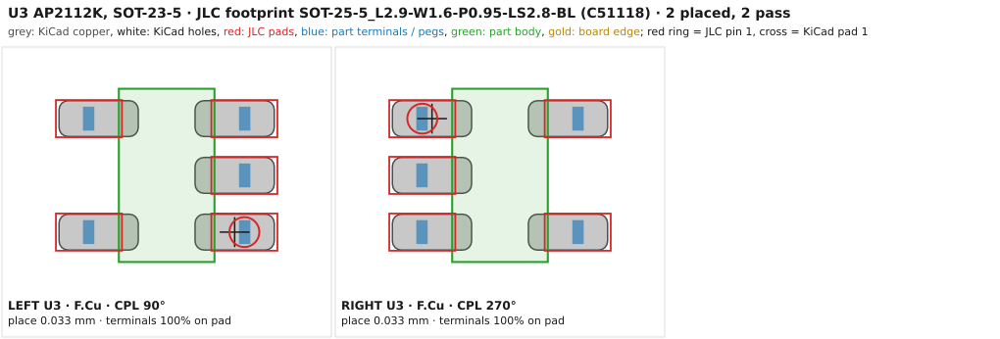</a><br><sub>U3 3.3 V LDO, SOT-23-5: both halves pass</sub></td><td align="center"><a href="docs/images/cpl-u4-u5-esd-sot23-6.svg">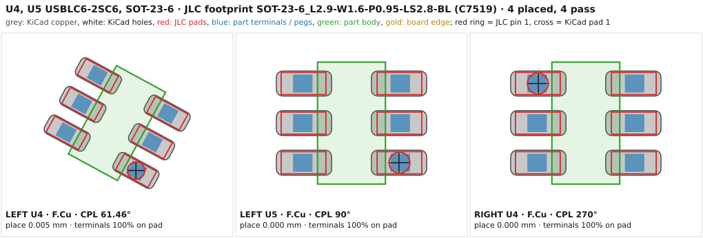</a><br><sub>U4, U5 ESD arrays: 4 placed, 4 pass</sub></td></tr>
<tr><td align="center"><a href="docs/images/cpl-y1-crystal-3225.svg">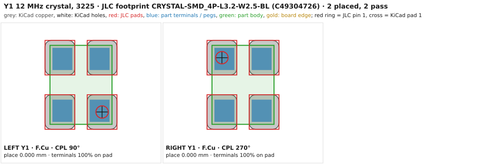</a><br><sub>Y1 12 MHz crystal: both halves pass</sub></td><td align="center"><a href="docs/images/cpl-d1-schottky-sod123.svg">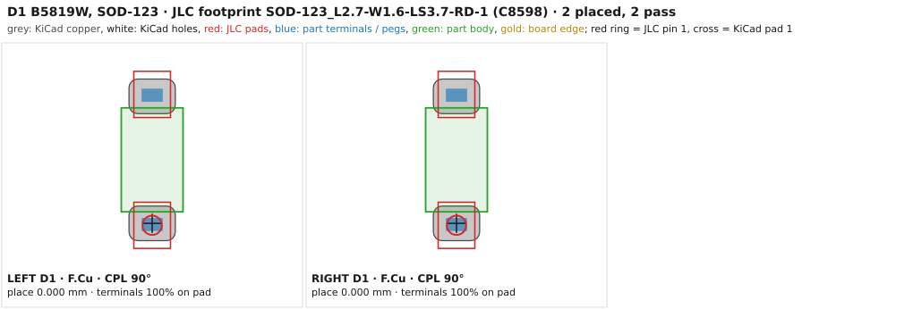</a><br><sub>D1 Schottky on the USB power path: both halves pass</sub></td></tr>
<tr><td align="center"><a href="docs/images/cpl-c-0402.svg">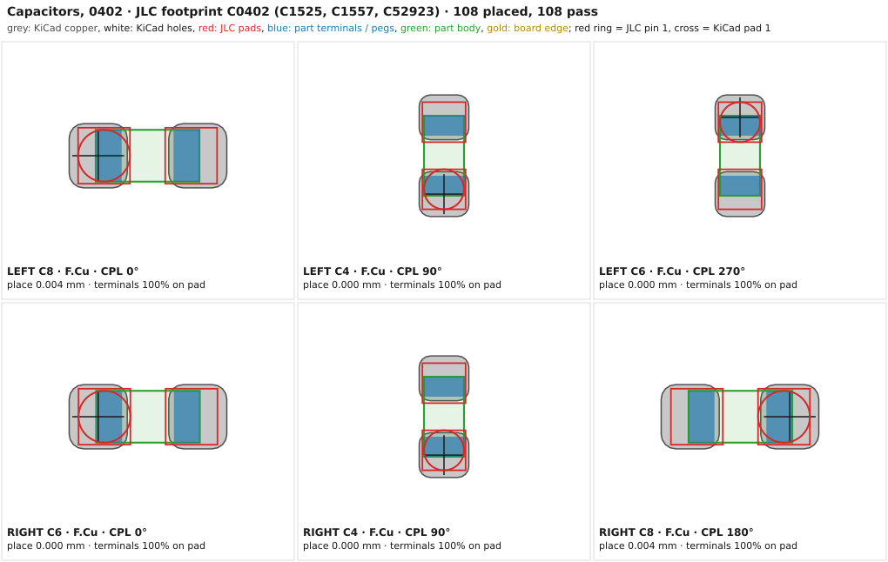</a><br><sub>0402 capacitors, every placement passes (rev B)</sub></td><td align="center"><a href="docs/images/cpl-r-0402.svg">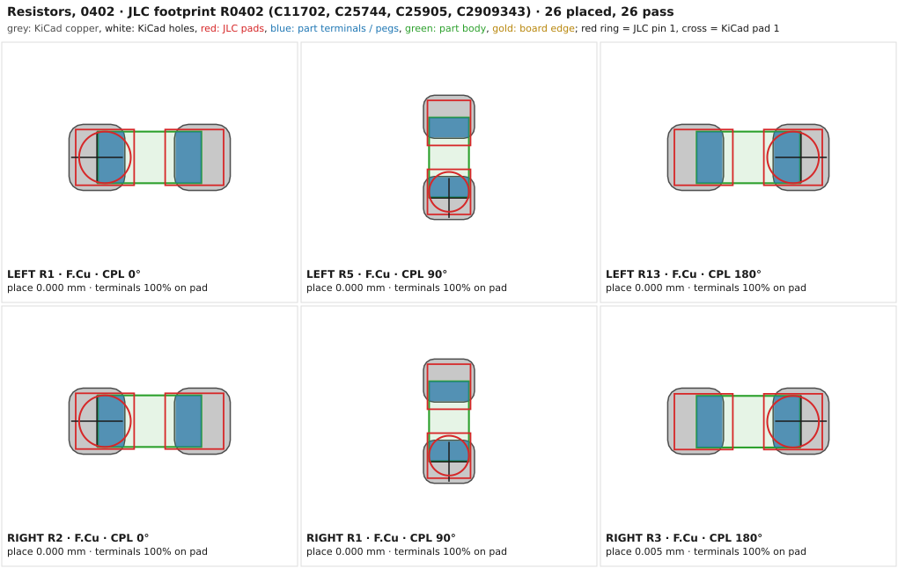</a><br><sub>0402 resistors, every placement passes (rev B)</sub></td></tr>
<tr><td align="center"><a href="docs/images/cpl-f1-ptc-1206.svg">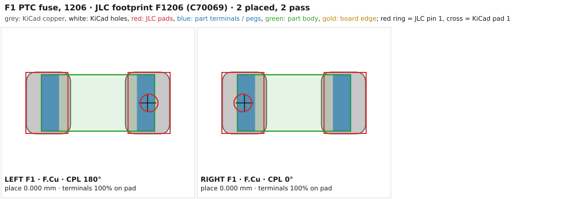</a><br><sub>F1 polyfuse on the TRRS power line: both halves pass</sub></td><td align="center"><a href="docs/images/cpl-j1-usb-c.svg">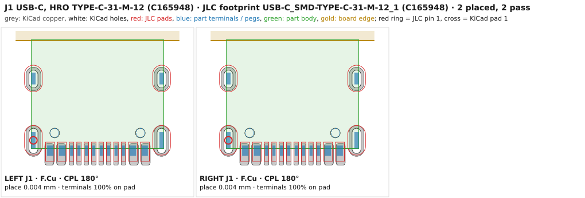</a><br><sub>J1 USB-C, mouth over the back edge: both halves pass</sub></td></tr>
<tr><td align="center"><a href="docs/images/cpl-j2-trrs-pj320d.svg">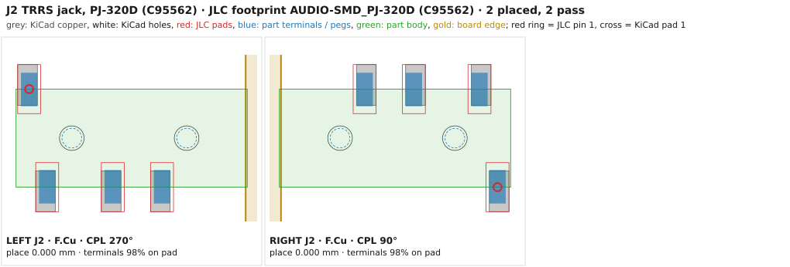</a><br><sub>J2 TRRS jack on the inner bump: both halves pass</sub></td><td align="center"><a href="docs/images/cpl-j3-display-socket.svg">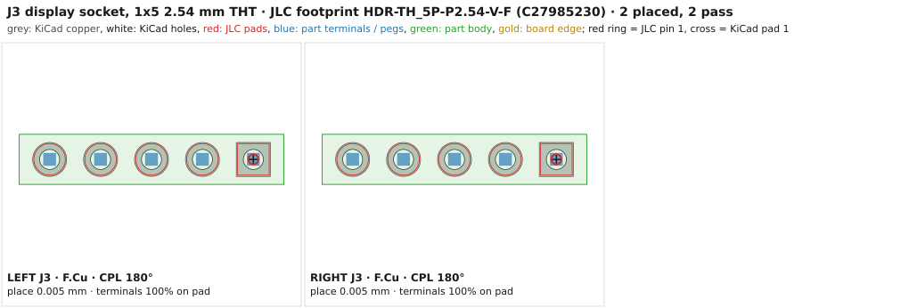</a><br><sub>J3 display socket: five contacts in five holes</sub></td></tr>
<tr><td align="center" colspan="2"><a href="docs/images/cpl-sw-tact-ts1088.svg">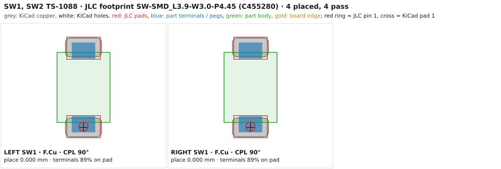</a><br><sub>SW1, SW2 BOOT and RESET tact switches: 4 placed, 4 pass</sub></td></tr>
</table>

</details>

## 🔧 Build it

> [!WARNING]
> **Plug the host into the LEFT half**, the ZMK central. **Never plug or unplug the TRRS cable while either half is powered**: the jack shorts its contacts against each other while the plug slides in. Unplug USB from both halves first.

The [build guide](docs/buildguide_en.md) has nine steps plus a [troubleshooting table](docs/buildguide_en.md#troubleshooting):

1. 🔍 [**Check the assembled PCBs.**](docs/buildguide_en.md#1-check-the-assembled-pcbs) Break each board out at its mouse-bite tabs and file the nubs flush, because the case leaves only about 0.3 mm around the PCB.
2. ⚡ [**Flash and test the bare boards**](docs/buildguide_en.md#2-flash-and-test-the-bare-boards) before anything is fitted: every socket, then every LED in the chain.
3. ✂️ [**Choose the power mode (JP1)**](docs/buildguide_en.md#3-choose-the-power-mode-jp1) before you close the case.
4. 📟 [**Plug in the displays.**](docs/buildguide_en.md#4-plug-in-the-displays) Trim the header pins flush on the glass side, and do not raise the module on an extra spacer.
5. 🖨️ [**Prepare the case**](docs/buildguide_en.md#5-prepare-the-case) by fitting a 3D-printed test top first.
6. 🧱 [**Assemble the case.**](docs/buildguide_en.md#6-assemble-the-case) Clip the 2u stabilisers into the upturned top shell **before** you close it.
7. 🎹 [**Fit the switches and keycaps.**](docs/buildguide_en.md#7-switches-stabilisers-and-keycaps) The stabilisers went in at step 6.
8. 🦵 [**Fit the tent legs**](docs/buildguide_en.md#8-tent-legs): friction washer, leg hub, then the M3 × 12 thumbscrew.
9. 🚀 [**Connect and use.**](docs/buildguide_en.md#9-connect-and-use)

| Power mode | JP1 on both halves | Cables |
|---|---|---|
| 🔗 **Linked power** (default) | bridged | one USB-C, into the left half; the right half runs from the TRRS cable |
| 🔌 **Split-powered** | cut on **both** halves | one USB-C per half; the TRRS cable carries only data and ground |

Tools: a soldering iron (for the display headers, and for a bare J1 shell leg or re-bridging JP1 if needed), flush cutters, tweezers (to short each socket's pads in the bare-board test), a file or sandpaper, a craft knife (to cut JP1), a 1.5 mm hex key or a Phillips driver, a Ø2.5 mm pin for BOOT/RESET, a multimeter, calipers and, optionally, an SWD debug probe for TP8–TP10 ([tools](docs/buildguide_en.md#tools)).

## 💾 Firmware

worxboard runs [ZMK](https://zmk.dev) as a custom HWMv2 board, `worxbend/worxboard`. ZMK is pinned in `firmware/zmk/config/west.yml` to `4dd95d7840eb3d5a3f59bb29fbf1ab054715ef85`, and CI asserts that pin. `zephyr/module.yml` and `build.yaml` sit at the repo root, so ZMK's user-config flow can build the repo directly. Every row compiles locally and in CI. None has run on hardware.

| Artifact | Board | Role | Status |
|---|---|---|---|
| ⭐ `worxboard_left_central` | `worxboard_left//zmk` | central; enumerates on USB; ZMK Studio on | **core** |
| ⭐ `worxboard_right_peripheral` | `worxboard_right//zmk` | peripheral; its USB gives power and flashing only | **core** |
| 🧪 `worxboard_right_central_EXPERIMENTAL` | `worxboard_right//zmk` | the right half as the central (host on the right) | untested on hardware |
| 🧪 `worxboard_left_peripheral_EXPERIMENTAL` | `worxboard_left//zmk` | the left half as the peripheral (pair it with the row above) | untested on hardware |
| 🧪 `worxboard2_left_EXPERIMENTAL`, `worxboard2_right_EXPERIMENTAL` | `worxboard2_*/rp2350a/m33/zmk` | RP2350A target for a later board revision (A4 stepping) | firmware only, no hardware |

**⚡ Flash it**

1. Download `worxboard-firmware` from a green [firmware run](https://github.com/w0rxbend/worxboard/actions/workflows/firmware.yml).
2. Get the **`RPI-RP2`** drive. A blank board shows it by itself. Otherwise double-tap <kbd>RESET</kbd>, or hold <kbd>BOOT</kbd>, tap <kbd>RESET</kbd> and release <kbd>BOOT</kbd>. On a running keyboard, `&bootloader` on layer 2 does the same.
3. Drag `worxboard_left_central.uf2` onto the left half and `worxboard_right_peripheral.uf2` onto the right half. The right half flashes through its own USB-C. If a board never shows `RPI-RP2`, a debug probe connects to the SWD pads TP8, TP9 and TP10.

**📟 The displays.** Both screens are laid out as 68 × 160 portrait and rotated onto the 160 × 68 panel. The left shows ZMK's built-in status screen, with USB at the top and the active layer at the bottom. The right shows a custom LVGL screen. The sketch below is drawn from the source comment in `worx_status_screen.c`; it is not a capture:

```
┌────────────┐
│  worx      │  ← logo
│  board     │
│ [ CAPS ]   │  ← lit lock: upper case in a 2 px frame
│   num      │  ← unlit: lower case
│   scrl     │
│  wired     │  ← static: the link is TRRS, no BLE or battery
└────────────┘
```

If both screens read upside down on the first board, set `CONFIG_WORXBOARD_DISPLAY_ROTATION_270=y` in `firmware/zmk/config/worxboard.conf`.

**🌈 The LEDs.** Each half's 37 LEDs are one ZMK underglow strip (WS2812 driver on PIO0, GP22), and GP23 switches their supply through ZMK's ext-power. They start dim (about 1 %), red and solid, and go dark with VLED off after 30 s without a key press. On layer 1 the thumb keys carry the controls, where the EZ's layer 1 has its RGB keys: next effect (solid, breathe, spectrum, swirl), on/off, solid, brightness down/up and hue −/+. A press on the left half also sets the right half over the wired split. Brightness is capped at 8 % for the one-cable case; [firmware.md](docs/firmware.md#rgb) has the bindings, the cap and how to raise it in split-power mode.

**🎛️ ZMK Studio** is enabled on the left central over USB. Unlock it with `&studio_unlock` on layer 2, then edit the keymap live in the [Studio web app](https://zmk.studio). The keymap is [`firmware/zmk/config/worxboard.keymap`](firmware/zmk/config/worxboard.keymap), with 3 layers × 74 bindings ([firmware.md](docs/firmware.md#keymap)). Build locally with `just fw`, or `just fw worxboard_left_central` for one row.

## 🧱 Case

`case/worxboard_case.py` is a build123d port of the [w0rxbend/ergodox](https://github.com/w0rxbend/ergodox) CNC case. Every dimension is a named constant, and the outline and every position come from `layout/`. Status: **modelled, checked and orderable, not yet made** ([case.md](docs/case.md)).

| Spec | Per half |
|---|---|
| 🧩 **Parts** | A CNC top shell with the 1.5 mm plate milled into its key well, a CNC bottom tray, and a separate 3 mm plate spacer (182.7 × 136.6 × 3.0 mm, MJF PA12) with a channel for each stabiliser wire |
| ✨ **Finish** | Aluminium 6061-T6, anodize **with** bead blasting, Strict (or Premium) appearance tier, if JLCCNC's form offers it, so the 2 halves and 6 legs match |
| 📏 **Size, mass** | 192.4 × 165.6 × 17.6 mm, 19.6 mm at the raised display bezel; about 349 g (top 140.6 g, tray 208.1 g) |
| 🔩 **Screws** | 8 × M2.5 × 12 countersunk per half from below into threads tapped in the top (no inserts): blind at the six edge bosses, tapped through at T1 and T5 under the key well |
| 🦶 **Feet** | 4 × Ø10 mm rubber feet in 0.6 mm recesses; an L or R mark engraved under each tray |
| 🦵 **Legs** | 3 mounts, one symmetric 6061 leg (4.9 g) with a TPU 95A foot cap, held by an M3 × 12 thumbscrew and a friction washer ([legs.md](docs/legs.md)); friction only, no click stops ([limits](docs/legs.md#known-limitations)) |
| ✅ **Checks** | `just model` passes every case check, `just corners` applies JLCCNC's radius-for-depth rule, and `just fitcheck` reports 0 mm³ against both PCB STEPs |

> [!WARNING]
> **🔩 Screw lengths matter.** Every thread in the top shell is blind: never use a screw longer than 12 mm in the edge bosses or 10 mm in T1/T5, or it stops before its head seats. The leg thumbscrews are **M3 × 12 without a collar (DIN 653)**, each with its friction washer, or the stock EZ spring thumbscrew once you have measured it. **Never DIN 464**: its collar sits in the leg's counterbore and the screw reaches 8.0 mm past the boss face, into the bottom of the blind thread.

> [!TIP]
> **🖨️ Print a test top first.** 3D-print the top, bottom and spacer of one half, fit an assembled PCB, its display and a few switches, and check the USB-C latch, the TRRS plug, the glass under the bezel, the BOOT/RESET holes and the C6R1 keycap ([before machining](docs/case.md#before-machining)).

**The Z stack**, from the top down ([case.md](docs/case.md#z-stack)):

| Z (mm) | Layer |
|---|---|
| 17.6 – 19.6 | 🔲 display bezel B1, 2.0 mm proud of the top face; the display pocket ceiling is at 18.6, under a 1.0 mm skin with the 26 × 12 mm window |
| 13.6 – 17.6 | ⌨️ key well; the pocket ceiling over the back strip and the TRRS bump is at 14.6 |
| 12.1 – 13.6 | 🔳 1.5 mm switch plate, milled into the top shell |
| 9.1 – 12.1 | 🟧 3 mm plate spacer, floating 0.5 mm above the PCB |
| 7.0 – 8.6 | 🟩 PCB, clamped between bosses in the top and posts in the tray |
| 3.0 – 7.0 | 🟨 cavity for the hot-swap sockets and diodes, about 2.2 mm margin |
| 0 – 3.0 | ⬛ floor of the bottom tray |

<table>
<tr><td align="center" width="50%" valign="top"><a href="case/renders/right_top_underside.png"></a><br><sub>🔳 Right top shell, underside: plate webbing, screw bosses, display pocket</sub></td><td align="center" width="50%" valign="top"><a href="case/renders/right_bottom_tray.png"></a><br><sub>⬛ Right bottom tray: the socket cavity and the eight M2.5 screw posts</sub></td></tr>
<tr><td align="center" valign="top"><a href="case/renders/right_back_usb.png">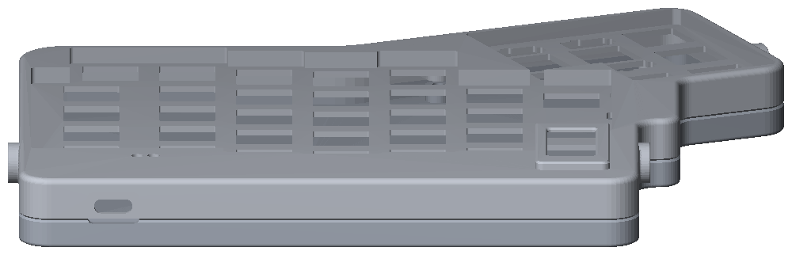</a><br><sub>🔌 Back wall of the right half, with the USB-C notch, the BOOT/RESET pin holes and the display bezel</sub></td><td align="center" valign="top"><a href="case/renders/spacer.png">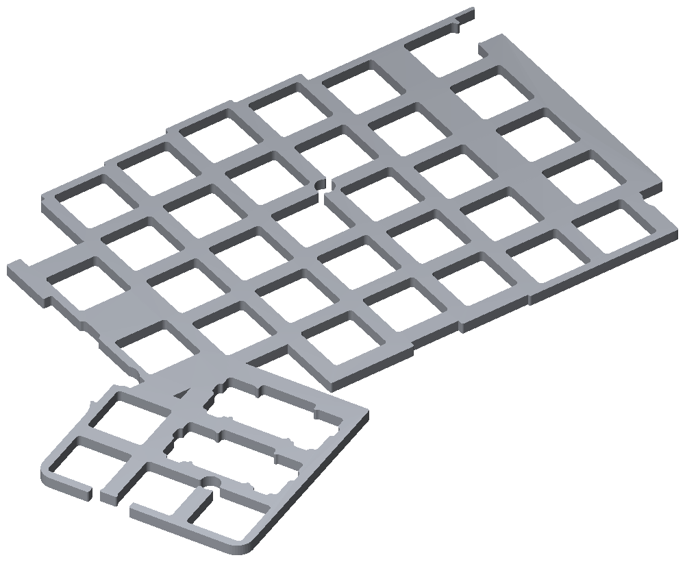</a><br><sub>🟧 3D-printed plate spacer, right half. This render predates the stabiliser-wire channels (ORDER-6)</sub></td></tr>
</table>

<table>
<tr><td align="center" width="33%" valign="top"><a href="case/renders/leg.png">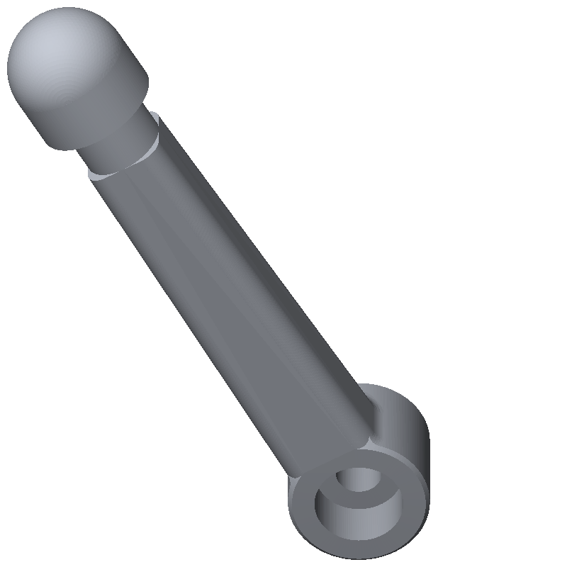</a><br><sub>🦵 Custom 6061 tent leg with its TPU foot cap</sub></td><td align="center" width="33%" valign="top"><a href="case/renders/leg_cap_tree.png">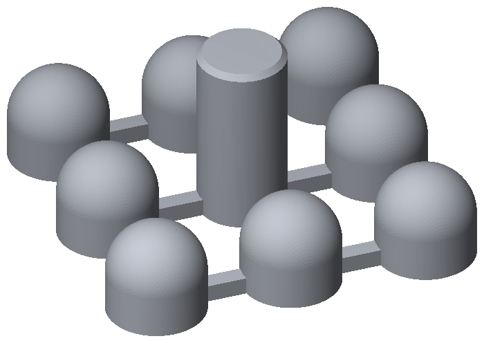</a><br><sub>🌲 The TPU print: 8 foot caps on one tree (6 + 2 spares)</sub></td><td align="center" width="33%" valign="top"><a href="case/renders/leg_section.png"></a><br><sub>📐 Outer leg mount section: M3 tapped pad and Ø10 boss</sub></td></tr>
</table>

<details>
<summary>🔬 Engineering views: case over PCB, and six cross-sections</summary>

<p align="center">
<a href="case/renders/overlay.png">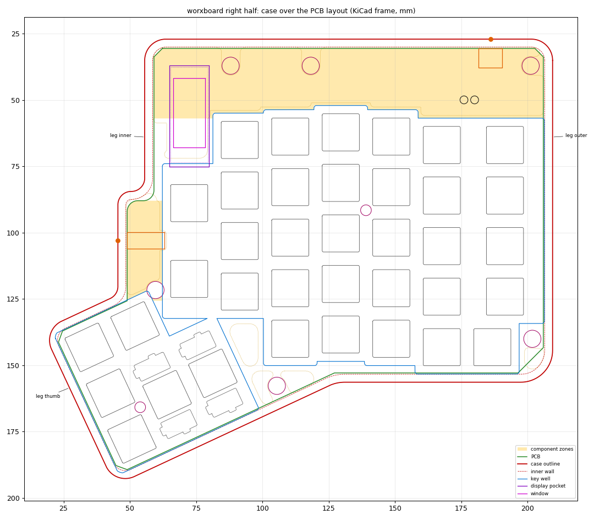</a><br><sub>The right-half case over the PCB layout. Red is the case outline, green the PCB, blue the key well, purple the display pocket, magenta the window, yellow the component zones, and maroon circles the screw bosses.</sub>
</p>

<p align="center">
<a href="case/renders/section.png">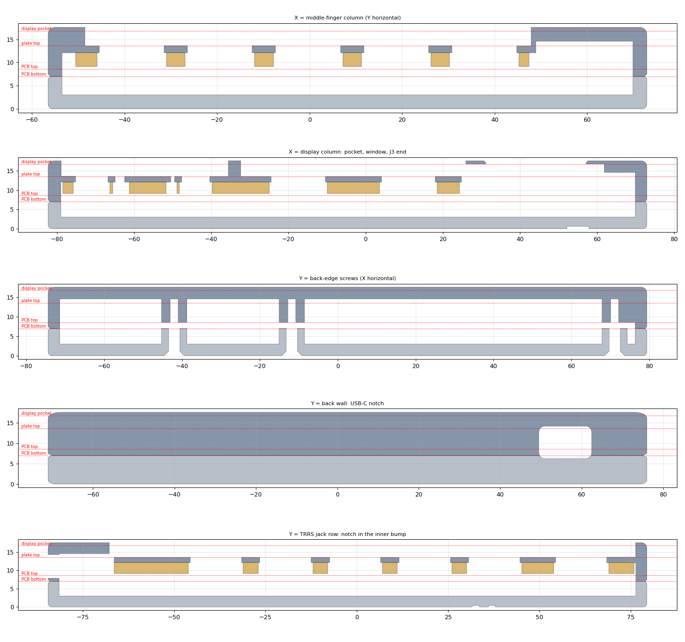</a><br><sub>Six sections through the right half: a key column, the display column, across the display, the back-edge screws, the USB-C notch and the TRRS row.</sub>
</p>

</details>

The plate DXFs in [`plates/`](plates/) are for cutting an optional separate 1.5 mm FR4 or aluminium plate. The ordered case does not need them, because its plate is milled into the top shell. The inner leg cannot fold flat forwards: it hits the TRRS bump at about 75°, and a plugged-in TRRS cable stops it even earlier.

## 🤖 Generated, not drawn

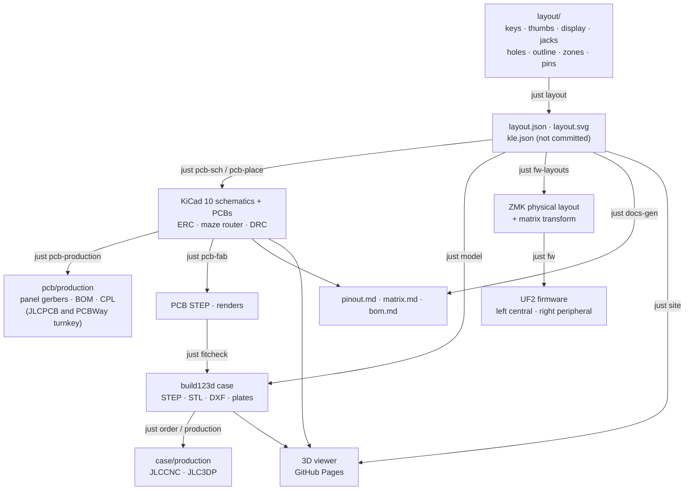

`layout/` is the single source of truth. `just layout-check` runs its tests, regenerates the outputs and fails if a committed `layout.json` or `layout.svg` is stale.

<details>
<summary>🧬 Inside layout/: the modules and what they write</summary>

| Module | Defines |
|---|---|
| `__init__.py` | The right-half KiCad frame; the left half is its mirror, x → 260 − x |
| `keys.py` | Main-block centres from the original ErgoDox PCB, 1u = 19.05 mm, 7 columns per half, the layer-0 legends |
| `thumbs.py` | The 25° six-key cluster around T0 (34.69894, 143.2687), with stabiliser holes on the 2u keys T4 and T5 |
| `display.py` | The 14 × 36 mm module over the old C6R0 cell, the J3 header, the 12 × 26 mm window |
| `jacks.py` | J1 USB-C flush with the back edge, J2 TRRS on the inner bump at y 103.0 |
| `holes.py` | 8 × M2.5 NPTH on the ErgoDox pattern, hole #7 moved to (88.0, 37.135) for the display |
| `outline.py` | The Edge.Cuts polygon from the original ErgoDox outline: jack tabs removed, back edge straight, TRRS bump added |
| `zones.py`, `pins.py` | Top-side component zones and part anchors; the RP2040 GPIO map, a frozen contract identical on both PCBs |

| Output | Committed | Used for |
|---|:-:|---|
| [`layout/build/layout.json`](layout/build/layout.json) (schema 1) | ✅ | PCB placement, the case, the ZMK layout, the generated docs, the viewer |
| [`docs/images/layout.svg`](docs/images/layout.svg) | ✅ | the plan view in [Layout and matrix](#-layout-and-matrix) |
| `build/kle.json` (keyboard-layout-editor) | ❌ git-ignored | only from the `worxboard-layout` CI artifact or a local `just layout` |

`just layout` (`python -m layout.export`) writes all three. On every push, CI fails if the committed `layout.json`/`layout.svg`, the ZMK layout dtsi, the PCB renders, the CPL drawings, `plates/*.dxf`, `pcb/production/` or `case/production/` drift from what the scripts generate. The generated docs are checked by `just docs-check` (run locally or in the manual `pages` workflow). The committed case renders and viewer screenshots are not checked.

</details>

Each PCB goes through this chain. Every stage is a script, run headless in a version-pinned container whose digest is recorded in [`tools/images.lock`](tools/images.lock):

> footprints → schematic → **ERC** → **netcmp** → placement → locked critical routes (QFN, USB, matrix, LED cells) → the repo's maze router → **DRC + schematic parity** → **checks.py** → KiKit fab → **cpl_check** → panel → **jlc_check** → order package

<details>
<summary>🏗️ The PCB pipeline, stage by stage</summary>

| Stage | Recipe | Container | What runs | Gate |
|---|---|---|---|---|
| 1–6 | `just pcb-sch <side>` | `kicad/kicad:10.0.7` | footprints, `design.py` → schematic, netlist | ERC 0 errors, `netcmp` |
| 7–8 | `just pcb-place <side>` | `kicad/kicad:10.0.7` | placement from `layout.json`, the GND and VLED planes, locked critical routes | |
| 10–12 | `just pcb-finish <side>` | `kicad/kicad:10.0.7` | the repo's maze router with rip-up (`route.py`), stitching, pours, GND ties, prune, pin-in-paste | DRC with schematic parity 0 / 0 / 0, `checks.py` |
| 13–14 | `just pcb-fab <side>` | `kicad/kicad:10.0.7-full` | KiKit JLC files, renders, Edge DXF, STEP | `netcmp --board`, `cpl_check` |
| P | `just pcb-production <side>` | `kicad/kicad:10.0.7` | KiKit panel and its DRC, panel and bare-board gerbers/BOM/CPL, the PCBWay files (`pcbway.py`) | `cpl_check`, `jlc_check`, `pcbway.py`; `pcb-production-check` compares byte for byte |

Every stage runs with `--network none`; the KiCad stages also set `PYTHONHASHSEED=0` and seed the KIIDs, so the same inputs give byte-identical boards. The scripts are in [`pcb/scripts/`](pcb/scripts/), and [electrical.md](docs/electrical.md#how-the-boards-are-made) walks through them.

</details>

| Gate (per half) | Recorded result, rev A |
|---|---|
| 🔌 ERC · 🧬 netcmp | 0 errors · 10 / 10 |
| 📏 DRC with schematic parity | 0 violations · 0 unconnected · 0 parity issues |
| ✅ `checks.py` | 14 / 14 (USB length and skew, crystal, decoupling, U1 GND return, via-in-pad, J1 pin-in-paste, outline and more) |
| 🎯 `cpl_check` | 119 / 119 placements, within 0.033 mm |
| 📦 `jlc_check` | left 11 / 11 with live stock, right 10 / 10 |
| ♻️ Rebuild | a from-scratch rebuild matches the committed board byte for byte (CI `rebuild` job) |
| 🚦 Gates | G1 display, G2 TRRS jack and G3 parts all **PASS**; 111 integration tests passed |

These rev A results are recorded in [verification.md](docs/verification.md): the integration tests and CI runs at `f4c95bb` (2026-11-04), and the board figures after the ORDER-1 and ORDER-4 fixes. Rev B adds the RGB chain to `netcmp.py`, each LED's position, cutout, turn and cap to `checks.py`, and the reverse-mount LED to `cpl_check.py`; its results are recorded there after the boards are regenerated, so the counts above will change. The badges at the top show the live state of `main`.

## 🧰 Build from source

You need [uv](https://docs.astral.sh/uv/), [just](https://just.systems/) and Docker (for KiCad 10.0.7, the ZMK toolchain and lychee). The firmware checks also call `python3` and a C compiler (`cc`) on the host. Python is pinned to 3.12.

```sh
just setup                    # .venv with every Python group (Python 3.12)
just layout-check             # layout tests + no-diff check of the committed contracts
just fw                       # every build.yaml row, in Docker -> build/fw/artifacts/*.uf2
just pcb-drc left             # DRC gate (schematic parity, 0 unconnected) + scripted checks
just pcb-fab left             # KiKit fab files, CPL check, renders, DXF, STEP -> build/left/
just pcb-production left      # the JLC and PCBWay order packages -> pcb/production/left/
just pcb-stock left 5         # package checks + live JLC stock for 5 + 5 boards (network)
just pcb-all                  # both PCBs from scratch, schematic to fab (~20 min per side)
just model order production   # case STEP/STL/DXF -> order package -> case/production/
just fitcheck                 # case vs build/<side>/worxboard-<side>.step: 0 mm3
just docs-check               # generated docs up to date + link check
just site                     # microsite into _site/ (just site-serve serves it on :8000)
just all                      # layout-check -> fw -> pcb-all -> model -> site
just --list                   # every recipe
```

The PCB stages run in `kicad/kicad:10.0.7` (`-full` for STEP and renders) with `--network none`; `just pcb-deps` installs their pinned Python packages into `pcb/.tools/` once.

<details>
<summary>📜 All 47 recipes, by area</summary>

Recipes come from each area's own file: the root [`justfile`](justfile), [`layout/layout.just`](layout/layout.just), [`firmware/firmware.just`](firmware/firmware.just), [`pcb/pcb.just`](pcb/pcb.just), [`case/case.just`](case/case.just) and [`site/site.just`](site/site.just).

| Area | Recipes | What they do, in the same order |
|---|---|---|
| 🏠 root | `default` · `setup` · `all` · `clean` | list the recipes · create `.venv` (Python 3.12) with the layout, case and dev groups · the full pipeline from a clean clone: layout-check, fw, pcb-all, model, site · remove Python caches and build outputs |
| 🧬 layout | `layout` · `layout-check` | regenerate `layout.json`, `layout.svg` and `build/kle.json` · tests, then regenerate and require no diff in the committed outputs |
| 💾 firmware | `fw [artifacts…]` · `fw-west` · `fw-clean` | build every `build.yaml` row, or the named ones, in Docker · create or refresh the west workspace (`west update` only when `west.yml` changed) · remove the firmware build outputs, keep the west workspace |
| 💾 firmware checks | `fw-layouts` / `fw-layouts-check` · `fw-keymap-check` · `fw-rotate-check` · `fw-check` · `fw-check-tests` | regenerate the physical-layout and transform dtsi, or fail if it is stale · 3 layers × 74 bindings, base layer equal to the `layout.json` legends · host test of the displays' portrait-to-panel pixel map · post-build: rotation on both core rows, the RGB brightness cap; on the right, no BLE/battery symbols, the `rgb_ug` behaviour and the flash budget · regression tests of those post-build checks |
| 🟩 pcb stages | `pcb-deps` · `pcb-sch <side>` / `pcb-sch-all` · `pcb-place <side>` · `pcb-finish <side>` | install the pinned container Python deps once · stages 1–6: footprints, schematic, ERC, netlist, netcmp (`-all` also requires no diff) · stages 7–8: placement, planes, locked critical routes · stages 10–12: maze router, stitching, zone fill, DRC gate, scripted checks |
| 🟩 pcb outputs | `pcb-drc <side>` · `pcb-fab <side>` · `pcb-render-check <side>` · `pcb <side>` / `pcb-all` | DRC gate and scripted checks on the committed board · stages 13–14: JLC files, renders, Edge DXF, STEP · after `pcb-fab`, the committed renders are current (pixel compare) · every stage for one side, or both |
| 🟩 pcb order | `pcb-package <side>` · `pcb-production <side>` · `pcb-production-check <side>` · `pcb-pcbway <side>` · `pcb-cpl-images` · `pcb-stock <side> [boards]` · `pcb-mpn [codes]` / `pcb-mpn-check` | stage P into `build/<side>/production` · stage P, then make it the committed `pcb/production/<side>/` · stage P, then require a byte-for-byte match · stage P, then copy only `pcbway/` into the committed package · redraw `docs/images/cpl-*.svg` · live JLC stock for the committed package (network; run it on order day) · refresh the manufacturer part numbers in `mpn.json` from LCSC (network) / check that it covers `design.py` |
| 🧱 case | `case-tests` · `model` · `fitcheck` · `corners` · `renders` | manufacturing-file comparison regressions · STEP / STL of both halves, legs, fit-check DXFs and `plates/*.dxf`, failing on any case check · interference with the PCB STEPs (or the layout zones until they exist) · every internal corner meets JLCCNC's radius-for-depth rule (needs model) · regenerate the PNGs in `case/renders` (needs model) |
| 🧱 case order | `order` · `production` / `production-check` | the order package in `case/exports/order` (needs model) · copy it into `case/production`, or fail if that differs (needs model + order) |
| 📚 docs and site | `docs-gen` · `docs-check` · `docs-links [args]` · `site` / `site-serve` | regenerate `docs/pinout.md`, `docs/matrix.md` and the BOM tables in `docs/bom.md` · generated docs up to date, then every local link and anchor resolves · link check with lychee in Docker (`--offline` skips external URLs) · build the microsite into `_site/`, or build it and serve it on port 8000 |

Pinned versions: KiCad `10.0.7`, kikit `1.8.1`, kicad-sch-api `0.5.6`, shapely `2.2.0`, build123d `0.13.0`, lychee `0.24.2`; image digests are in [`tools/images.lock`](tools/images.lock), and CI and `just fw` run the images by those digests.

</details>

## 📦 Get the files

These files are committed, so you can open them straight from the repo. GitHub shows the PDFs and the STLs in the browser:

| What | Files |
|---|---|
| 🟩 KiCad 10 projects | [`pcb/left/`](pcb/left/) · [`pcb/right/`](pcb/right/) (`.kicad_pro`, `.kicad_sch`, `.kicad_pcb`) |
| 🏭 JLCPCB order zips | [left](pcb/production/left/worxboard-left-jlc-order.zip) · [right](pcb/production/right/worxboard-right-jlc-order.zip) |
| 🏭 PCBWay files | `pcbway/` in each side's folder of [`pcb/production/`](pcb/production/): `bom.csv`, `centroid-panel.csv`, `centroid-bare-board.csv`, `README.md` ([ordering-pcbway.md](docs/ordering-pcbway.md)) |
| 📐 Machining drawings (PDF) | [left top](case/production/jlccnc/worxboard_left_top.pdf) · [right top](case/production/jlccnc/worxboard_right_top.pdf) · [left tray](case/production/jlccnc/worxboard_left_bottom.pdf) · [right tray](case/production/jlccnc/worxboard_right_bottom.pdf) · [leg](case/production/jlccnc/worxboard_leg.pdf) |
| 🧊 CAD (STEP) | the `.step` files next to those PDFs in [`case/production/jlccnc/`](case/production/jlccnc/) |
| 🖨️ Printable STLs | [left spacer](case/production/jlc3dp/worxboard_left_spacer.stl) · [right spacer](case/production/jlc3dp/worxboard_right_spacer.stl) · [foot-cap tree](case/production/jlc3dp/worxboard_leg_cap_tree.stl) |
| ✂️ Plate DXFs | [left](plates/worxboard-plate-left.dxf) · [right](plates/worxboard-plate-right.dxf) |
| 🧬 Layout and keymap | [`layout.json`](layout/build/layout.json) · [`worxboard.keymap`](firmware/zmk/config/worxboard.keymap) |

The top-shell and tray STLs are not committed (`case/exports/` is git-ignored); they come from the `worxboard-case` artifact or `just model`.

The layout, firmware, pcb and case workflows run on every push to `main`, on pull requests and on `v*` tags. Download the artifacts of a green run:

| Workflow | Artifact | Contents |
|---|---|---|
| [layout](https://github.com/w0rxbend/worxboard/actions/workflows/layout.yml) | `worxboard-layout` | `layout.json`, `layout.svg` and `kle.json`. The KLE file is not committed, so this artifact (or `just layout`) is the only way to get it |
| [firmware](https://github.com/w0rxbend/worxboard/actions/workflows/firmware.yml) | `worxboard-firmware` | six `.uf2` files: `worxboard_left_central`, `worxboard_right_peripheral` and the four `*_EXPERIMENTAL` rows ([firmware.md](docs/firmware.md)) |
| [pcb](https://github.com/w0rxbend/worxboard/actions/workflows/pcb.yml) | `worxboard-pcb-left`, `worxboard-pcb-right` | KiKit's raw bare-board fab files, the board STEP, the Edge.Cuts DXF, the DRC report and the renders. To order, use the committed [`pcb/production/`](pcb/production/) instead ([ordering-jlcpcb.md](docs/ordering-jlcpcb.md)) |
| [pcb](https://github.com/w0rxbend/worxboard/actions/workflows/pcb.yml) | `worxboard-pcb-production-left`, `worxboard-pcb-production-right` | the rebuilt order package, which must equal `pcb/production/<side>/` |
| [pcb](https://github.com/w0rxbend/worxboard/actions/workflows/pcb.yml) | `worxboard-pcb-erc`, `worxboard-pcb-rebuild-*` | ERC reports and netlists; the from-scratch rebuilds and their DRC reports |
| [case](https://github.com/w0rxbend/worxboard/actions/workflows/case.yml) | `worxboard-case` | case STEP/STL/DXF, plates, renders, the build report and the order package, also committed in [`case/production/`](case/production/README.md) ([case.md](docs/case.md)) |

[`release.yml`](.github/workflows/release.yml) publishes a GitHub pre-release when a `v*` tag is pushed. It attaches each half's order package (`pcb/production/<side>/` with its `pcbway/` folder), the case order package, the bare-board and case zips, one `.uf2` per `build.yaml` row and `SHA256SUMS.txt`. Hardware releases are tagged with the board revision, such as `v*-revB`. The only tag so far is `v0.1.0-revA`, a rev A pre-release.

<details>
<summary>⚙️ The six workflows: triggers, jobs and artifacts</summary>

| Workflow | Runs on | Jobs | Artifacts |
|---|---|---|---|
| [layout](https://github.com/w0rxbend/worxboard/actions/workflows/layout.yml) | push to `main`, `v*` tags, PRs, manual | `uv sync --locked`, `just layout-check`, generated-docs check, `pytest tests/integration` (build-output tests skip) | `worxboard-layout` |
| [firmware](https://github.com/w0rxbend/worxboard/actions/workflows/firmware.yml) | same | ZMK SHA pin, dtsi regen, keymap, rotation host test → one build per `build.yaml` row (`fw_check.py` on the core rows) → merge | `worxboard-firmware` |
| [pcb](https://github.com/w0rxbend/worxboard/actions/workflows/pcb.yml) | same | schematics · board × 2 (DRC, fab, render compare) · order package × 2 · CPL overlays · case fit · rebuild × 2 | `worxboard-pcb-*` |
| [case](https://github.com/w0rxbend/worxboard/actions/workflows/case.yml) | same | model, plates no-diff, fitcheck, corners, renders, order, production-check | `worxboard-case` |
| [pages](.github/workflows/pages.yml) | manual only | generated-docs check, offline link check, optional case model, `just site`, deploy | the [GitHub Pages site](https://w0rxbend.github.io/worxboard/) |
| [release](.github/workflows/release.yml) | `v*` tag only | firmware, pcb × 2, case, integration tests, GitHub pre-release | the release assets |

</details>

## 🐛 Known open issues

- 🧪 **Not built yet.** No board of either revision has been made. The displays, the wired split, the forwarding of the lock indicators, the role-swap firmware and the XOSC start-up with the new crystal are untested on hardware ([verification.md](docs/verification.md#not-verified-until-a-board-is-built)). The J2 contact naming and the case fit (USB-C and TRRS plug seating, the BOOT/RESET pin holes, C6R1 keycap clearance with the display set back) also wait for a real board; check the fit on a 3D-printed test top.
- 🌈 **The LEDs are untested on hardware.** The chain's timing through the U7 buffer, VLED switching by U6 and its current limit, the real current at the brightness cap, the order of the chain and the RGB commands the left half relays to the right have only been checked in the design files and the ZMK source ([firmware.md](docs/firmware.md#known-issues)). ZMK drives each half's chain as underglow, so the effects cover the whole board: there are no per-key or per-layer colours.
- 🔆 **Brightness cap.** The firmware caps the LEDs at 8 % so that one USB-C cable can feed both halves: the right half's LEDs run over the TRRS cable through the 250 mA F1. Raise the cap (to 20 % at most) only in split-power mode, with each half on its own USB-C and JP1 cut on both; CI and `just fw-check` reject a raised cap, so that is a local build ([firmware.md](docs/firmware.md#raising-the-cap-split-power-mode-only)).
- 💾 **Right-half settings writes.** The right half now keeps its own RGB state in flash, and each half writes its settings about a minute after an RGB change or an idle transition. The RP2040 flash driver locks interrupts while it writes; whether that can drop a frame on the 115 200 baud split UART is unmeasured. A keyboard left idle for more than about 90 s before it is unplugged boots dark: press the RGB toggle.
- 🔄 **Display orientation.** Both screens are laid out portrait and turned by the firmware. Which panel end is pixel 0 comes from ZMK's code and the vendor's images, not from a datasheet. If the screens read upside down, set `CONFIG_WORXBOARD_DISPLAY_ROTATION_270=y` ([firmware.md](docs/firmware.md#known-issues)).
- 🎯 **Fab placement.** Every JLC CPL placement is proven against JLC's own footprints, but JLC does not document its bottom-side convention. Check the sockets, diodes and LEDs in the placement preview ([ordering-jlcpcb.md](docs/ordering-jlcpcb.md#placement-preview-checklist)). The hot-swap socket C41430893 is a second-source part, and nobody has reported JLC assembling it yet. At PCBWay, use only the `pcbway/` files, never the JLC CPL.
- ⚡ **Plug-in capacitance.** The host sees about 40 µF on VSYS across both halves at plug-in, above USB's nominal 10 µF. Almost every host copes; it is documented, not changed (REVB-3, [electrical.md](docs/electrical.md#review-notes-kept-rev-b-deviations-revb-3)). The LEDs' capacitance sits behind U6 and adds nothing.
- 📦 **Stock** moves daily. Re-check it on the day you order ([Order it](#-order-it)). J3 (C27985230) has no drop-in alternate that fits the case ([alternates](docs/ordering-jlcpcb.md#if-a-part-is-out-of-stock)).
- 🧊 **3D models.** KiCad has no model for the USB-C, the TRRS jack or the hot-swap socket, so the board STEP lacks those bodies. The case fit check adds their layout envelopes instead.
- 🐳 **Build image.** The firmware builds in `zmkfirmware/zmk-build-arm:stable` at the digest in `tools/images.lock`; Zephyr comes from ZMK's branch ref `v4.1.0+zmk-fixes`, which can move.
- 💾 **RP2350A target** (`worxboard2`): settings, the RGB state included, do not persist, because the flash map and NVS are forced off.
- 🧠 **LVGL heap.** Heap use has not been measured on hardware. On a 64-bit host the right screen peaks at about 5.2 KB of its 8 KB heap, and the left at about 4.7 KB against ZMK's 4 KB default.
- 🖼️ **Stale preview.** `spacer.png` predates the stabiliser-wire channels. CI re-renders the case into the `worxboard-case` artifact.
- 📜 **Licence split** ([below](#-license)): it still needs the maintainer's confirmation.

## 🔭 Future work

Listed in [firmware.md](docs/firmware.md#future-work):

- 🧠 RP2350A hardware on a later revision (needs the A4 stepping, erratum E9). The `worxboard2` firmware rows already build.
- 🔗 TRRS detect on GP21 (TP11) and a runtime role swap.
- 🌈 Per-key RGB effects (layer or lock colours): ZMK at the pinned revision has only the underglow strip.
- 🎛️ Encoders, a TFT display on TP1–TP3.

## 🌳 Repository layout

<details>
<summary>📂 Show the tree</summary>

```
layout/              single source of truth; layout/build/layout.json is the committed contract
pcb/                 KiCad 10 projects per half (left/, right/), worxboard symbol/footprint
                     library (lib/), generator scripts (scripts/: design, schematic, placement,
                     routing, checks, fab, panel), the JLC and PCBWay order packages (production/)
firmware/zmk/        ZMK board module (RP2040 worxboard, RP2350A worxboard2), keymap,
                     custom screen, scripts
zephyr/module.yml    Zephyr module entry point for the ZMK build
build.yaml           ZMK build matrix
case/                build123d case, drawings, fit check, overlay, renders/, the JLCCNC/JLC3DP
                     order package (production/; exports/ is git-ignored)
plates/              plate DXFs, for cutting an optional separate 1.5 mm plate
docs/                build guide, BOM, electrical, pinout, matrix, ordering, case, legs,
                     firmware, spec; images/ (PCB renders, layout.svg, viewer screenshots,
                     CPL proofs)
site/                microsite: web/ (product page, three.js viewer), guide.template.html, build_site.py, gen_docs.py, pcbdata.py
tests/integration/   integration tests: pins, gates, stock, stabilisers, release assembly
tools/               container helpers and pinned image digests
.github/workflows/   layout, firmware, pcb, case (push, PR, tags); pages (manual); release (v* tags)
```

</details>

## 📚 Documentation

| | Document | Contents |
|---|---|---|
| 🔧 **Build** | [buildguide_en.md](docs/buildguide_en.md) | board check, bare-board flashing, JP1 power modes, displays, assembly, troubleshooting |
| | [shopping-list.md](docs/shopping-list.md) | the four orders and every off-board part for one keyboard |
| | [ordering-jlcpcb.md](docs/ordering-jlcpcb.md) | the turnkey JLCPCB order step by step: form fields, placement checks, alternates, cost estimate |
| | [ordering-pcbway.md](docs/ordering-pcbway.md) | the same order at PCBWay: its own BOM and centroid files, the form, substitutions, manufacturer part numbers |
| | [soldering-at-home.md](docs/soldering-at-home.md) | bare boards and loose parts instead of factory assembly: which parts need reflow, what to order, the order of work (an untested path) |
| | [bom.md](docs/bom.md) | bill of materials with LCSC numbers (generated), JLC fees, the ordering gates |
| 📖 **Reference** | [electrical.md](docs/electrical.md) | power path, TRRS link, USB-C, MCU support circuit, display, per-key RGB, reference designators, PCB rules and pipeline |
| | [pinout.md](docs/pinout.md) | RP2040 GPIO map, TRRS contacts, display header, part positions, holes (generated) |
| | [matrix.md](docs/matrix.md) | key matrix per half, sockets and diodes, the ZMK 6 × 14 transform, keymap order (generated) |
| | [firmware.md](docs/firmware.md) | ZMK builds, flashing, host behaviour, keymap, displays, RGB (controls, brightness cap, split behaviour), known issues |
| | [case.md](docs/case.md) | the Z stack, changes from the ErgoDox case, the order package, fasteners, previews |
| | [legs.md](docs/legs.md) | tent/tilt legs: mounts, positions, the custom leg |
| 🧪 **Design and QA** | [design.md](docs/design.md) | the frozen rev A specification |
| | [deviations.md](docs/deviations.md) | every change from the specification, by work-stream |
| | [verification.md](docs/verification.md) | integration results, CI, the order-package checks, gates G1–G3, and what only a built board can confirm |
| | [sources.md](docs/sources.md) | prior art, tools and attribution |

Order sheets: [`pcb/production/left/README.md`](pcb/production/left/README.md), [`pcb/production/right/README.md`](pcb/production/right/README.md), the PCBWay `README.md` in each side's `pcbway/`, [`case/production/README.md`](case/production/README.md) and its two `ORDER_NOTES.md`. History is in [`CHANGELOG.md`](CHANGELOG.md). `site/gen_docs.py` generates `docs/pinout.md`, `docs/matrix.md` and the BOM tables in `docs/bom.md` from `layout/build/layout.json`, `pcb/scripts/design.py` and the committed boards. Run `just docs-gen` after a layout or PCB change; `just docs-check` fails if they are stale.

## 🙏 Credits

- ⌨️ [ErgoDox](https://www.ergodox.io/) by Dominic Beauchamp, and the original PCB [bishboria/ErgoDox](https://github.com/bishboria/ErgoDox) by Fredrik Atmer and contributors: switch centres, thumb cluster, holes and outline.
- 🦵 [ErgoDox EZ](https://ergodox-ez.com) by ZSA: the product this keyboard follows (layout, tent legs, default keymap). Not affiliated.
- 🧠 [foostan/crkbd](https://github.com/foostan/crkbd) (Corne v4): the RP2040 support circuit, the BOM parts and the build-guide format.
- 🧱 [w0rxbend/ergodox](https://github.com/w0rxbend/ergodox) v0.6.1: the CNC case, legs, drawings and the three.js viewer.
- 💾 [ZMK](https://github.com/zmkfirmware/zmk) and the [QMK](https://github.com/qmk/qmk_firmware) `ergodox_ez` default keymap.
- 🛠️ KiCad, KiKit, build123d, three.js.

Full list: [docs/sources.md](docs/sources.md); licences: [THIRD_PARTY.md](THIRD_PARTY.md).

## 📜 License

- Code (`layout/`, `pcb/scripts/`, `case/*.py`, `firmware/`, `tools/`, `site/`): [GPL-3.0](LICENSE). The ZMK board files under `firmware/zmk/boards/` carry ZMK's MIT licence in their SPDX headers.
- Hardware (`pcb/` KiCad files and libraries, case geometry outputs, `plates/`, `docs/`): [CERN-OHL-S-2.0](LICENSE-HARDWARE). **Maintainer to confirm** this split before the first hardware tag.
- Per-file headers under `firmware/zmk/`: the board files, keymaps and C sources say `SPDX-License-Identifier: MIT`, and the Python scripts say GPL-3.0-or-later. The confirmation above covers them too.
- Third-party material: [`THIRD_PARTY.md`](THIRD_PARTY.md); attribution in [docs/sources.md](docs/sources.md).

The key and mounting-hole coordinates come from the original ErgoDox PCB by Fredrik Atmer and contributors (GPL-3.0). ErgoDox EZ is a product of ZSA Technology Labs and nice!view of Nice Keyboards; Cherry MX, Kailh, Raspberry Pi and JLCPCB are trademarks of their owners. This project is not affiliated with or endorsed by any of them.

<div align="center">

<a href="#-contents">⬆️ Back to contents</a>

<sub>⌨️ worxboard rev B · per-key RGB · four layers · results pending, not orderable yet · KiCad 10 · build123d · ZMK</sub>

</div>
