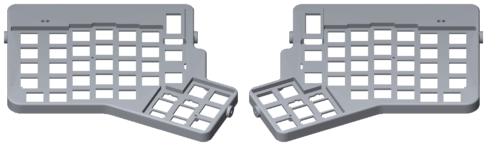
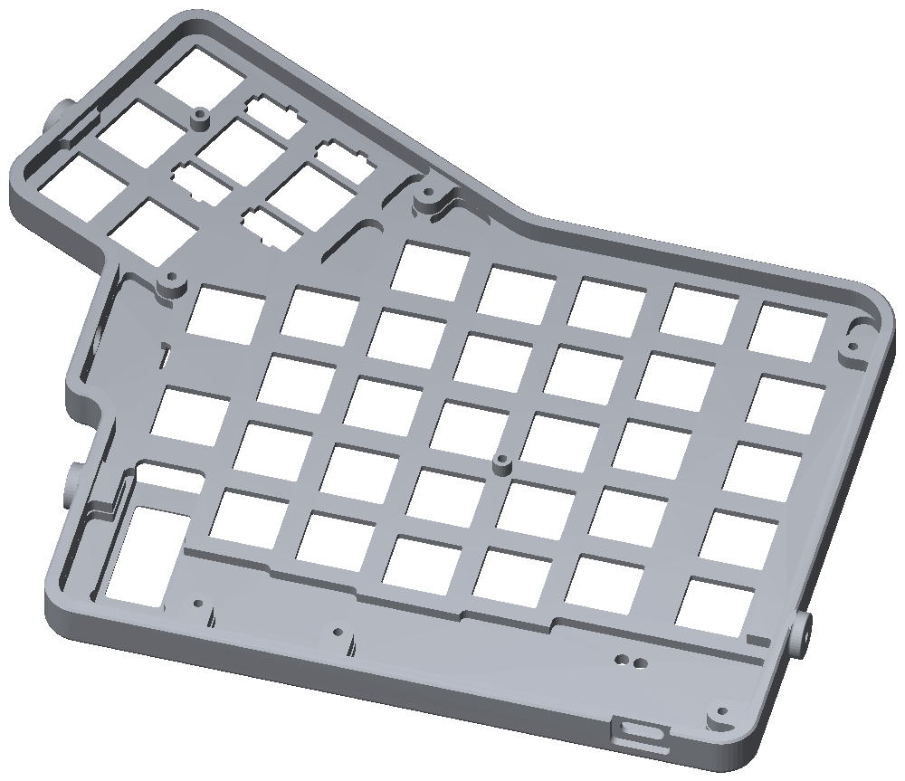
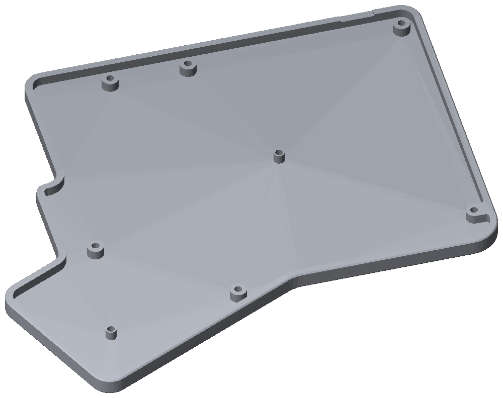
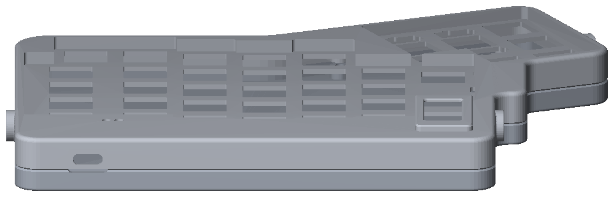
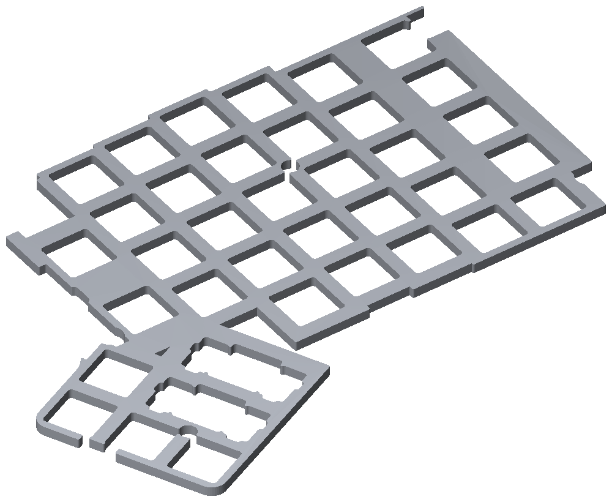
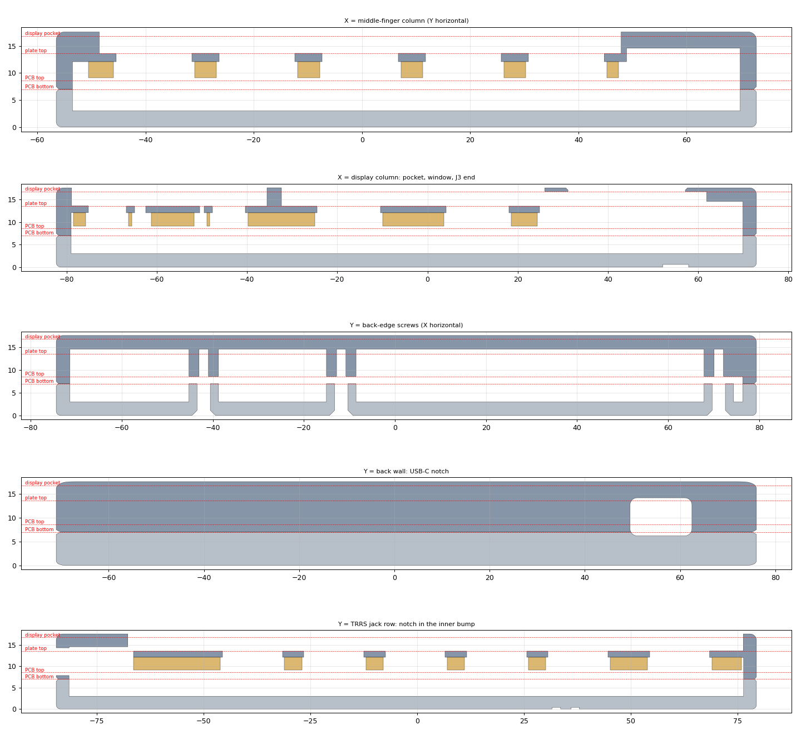
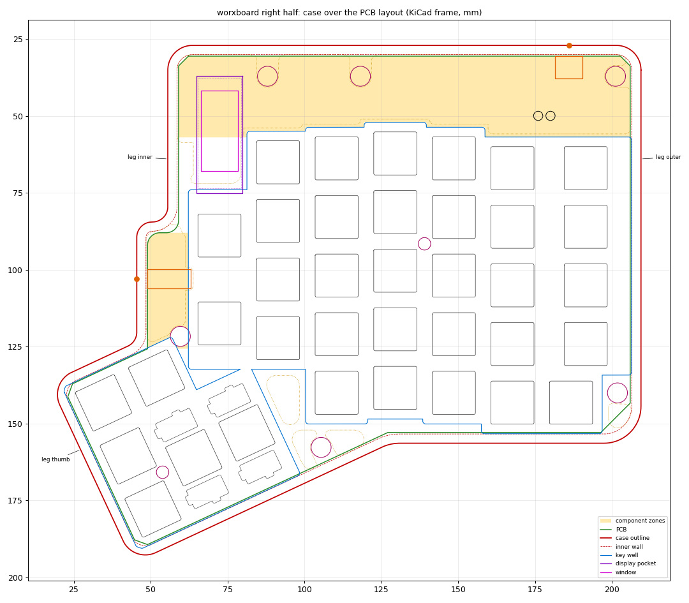

# Case and plates

The case is `case/worxboard_case.py`, a [build123d](https://github.com/gumyr/build123d) port of the
[w0rxbend/ergodox](https://github.com/w0rxbend/ergodox) CNC case (spec §10). Every dimension is a
named constant, and the outline and all positions are imported from [`layout/`](../layout/), so
the case always matches the PCB.

> [!NOTE]
> **Modelled and checked, not yet made.** `just model` builds both halves and passes every case
> check, and `just fitcheck` reports **0 mm³** of interference against both PCB STEPs plus the
> `layout` envelopes of the parts those STEPs have no body for: J1 (USB-C), J2 (TRRS), J3 with the
> display module, and the hot-swap sockets (the `fit` job of the
> [`pcb` workflow](https://github.com/w0rxbend/worxboard/actions/workflows/pcb.yml) runs it on every
> push). Those envelopes are the layout's assumed sizes: gates G1 and G2 found the real display
> module 0.7 mm longer and the real PJ-320D 2.1 mm longer than them, so the pocket and the bump
> relief still need the fixes listed in [verification.md](verification.md#open-items-that-block-ordering)
> before ordering. Nothing has been printed or machined.



The case has three parts per half, like the reference ErgoDox case: a **top shell** with the
1.5 mm switch plate milled into its key well, a **bottom tray**, and a separate 3 mm **plate
spacer** between the plate and the PCB. The PCB is clamped between bosses in the top and posts in
the tray.

| | Per half |
|---|---|
| Size | 192.4 × 165.6 × 17.6 mm (top 10.6 + tray 7.0; including the leg bosses) |
| Mass (6061-T6) | about 348 g: top 139 g, tray 208 g |
| Plate spacer | 182.7 × 136.6 × 3.0 mm, 21 cm³ (printed or laser-cut) |
| Fasteners | 6 × M2.5 × 14 and 2 × M2.5 × 12 countersunk (ISO 10642) |
| Threads in the top | 8 × M2.5 (6.0 mm deep, 3.9 mm under the key well) and 3 × M3 for the legs |
| Feet | 4 × Ø10 mm rubber feet in 0.6 mm recesses |
| Tent legs | 3 custom legs (4.9 g each in 6061) with TPU foot caps and the stock M3 thumbscrews ([legs.md](legs.md)) |

## Z stack

| Z (mm) | Layer |
|---|---|
| 0–3 | floor of the bottom tray |
| 3–7 | cavity (hot-swap sockets and diodes, about 2.2 mm margin) |
| 7–8.6 | PCB |
| 9.1–12.1 | plate spacer |
| 12.1–13.6 | plate |
| 13.6–17.6 | key well |
| 14.6 | pocket ceiling over the back strip and the TRRS bump |
| 16.8 | display pocket ceiling (0.8 mm skin under the window) |

Wall 3.0 mm, top fillet 1.5 mm, seam chamfer 0.5 mm, well clearance 0.6 mm around each key cell.

## What changed from the reference ErgoDox case

| Feature | worxboard rev A |
|---|---|
| Outline | The PCB polygon from `layout.outline(side)` offset by 3.5 mm (0.5 clearance + 3.0 wall). Short PCB corner chamfers collapse into one filleted corner. Radii by vertex class: back corners r8 (r10 left too little cavity clearance), front-outer r12, thumb r8, concave r6 / r14, TRRS bump r5 (deviations WS3-1, WS3-2). The cavity keeps ≥ 0.3 mm to the PCB everywhere. |
| Keys | 37 per half (the inner top key is the display). The two 2u thumb keys get Cherry-spec plate stabiliser cut-outs (6.65 × 12.3 mm with the side and end notches; the 0.875 mm side notch is 1.0 mm for a 1 mm end mill). Each cut-out's long half points the same way as the PCB's Ø4.0 stabiliser holes: both read `layout.stab_dir`, and the left half is the mirror image (deviation REVIEW-FIX-7). The key well is clipped to keep 2.0 mm of wall at the T0/T3 cap corners (WS3-4). |
| Screws | 8 × M2.5 on the ErgoDox pattern, with hole 7 moved to (88.0, 37.135) for the display. |
| Display | A pocket over the module + 0.5 mm, from the PCB top (Z 8.6) to Z 16.8, through the spacer and plate, and a 26 × 12 mm viewing window (r1, 0.5 mm chamfer) through a 0.8 mm skin. The window is centred on the LCD viewing area at (72.39, 56.54), which leaves a 4.5 mm top-skin bar to the C6R1 key well (deviation REVIEW-FIX-6). `display_check()` asserts the window is inside the pocket. The pocket opens a 1.1 mm strip of the C6R1 well floor, which the module fills to within 0.5 mm (WS3-5). |
| USB-C | On **both** halves: a 9.4 × 3.6 mm notch (r1.6) in the back wall at x 186.0 (right frame), Z centre 10.2, with a 13 × 8 mm outside recess 1.8 mm deep so a plug seats fully. The recess continues 0.8 mm into the tray. |
| TRRS | A Ø6.5 hole through the inner bump wall at y 103.0, on the jack axis (Z 11.1); `jack_check()` asserts it matches `layout` J2 within 0.2 mm. The bump pocket leaves 0.5 mm over the 5.5 mm `layout` jack body; the real PJ-320D is 5.0 mm tall (G2 PASS) but 14.1 mm long, 2.1 mm longer than the relief (G2 open item). The plug has to pass 3.65 mm of Ø6.5 hole before it seats (see [TRRS cable](#trrs-cable)). |
| Back strip | A relief pocket over Z_BACK and Z_TRRS (ceiling 14.6), with a 1 mm wall kept to the key well (WS3-6), and Ø3 pin holes through the top over BOOT (176, 50) and RESET (180, 50). |
| Legs | The three stock positions on the derived walls; M3 drill 5.5 mm at the outer and thumb legs (≥ 5.0 checked), 7.5 mm at the inner leg (WS3-3). |
| Removed | The EZ's capacitor pocket, LED windows and reset hole, and the back-wall jack notches. |
| Halves | `build_top(side)` / `build_bottom(side)` build each half from the mirrored layout, with an engraved `L` / `R` under the tray. The model asserts left = mirror(right). |

Coordinates are in the right-half KiCad frame; [`overlay.png`](../case/renders/overlay.png) draws
the case over the PCB layout.

## Files

`just model` writes these to `case/exports/` (git-ignored); the `case` workflow uploads them as the
`worxboard-case` artifact, together with the renders and the order package.

| File | What it is |
|---|---|
| `worxboard_{left,right}_{top,bottom}.step` / `.stl` | case parts |
| `worxboard_{left,right}_spacer.step` / `.stl` | plate spacers (print or mill) |
| `worxboard_leg.step` / `.stl`, `worxboard_leg_cap.step` / `.stl` | tent leg and TPU foot cap |
| `worxboard_right_assembly_with_legs.step` / `.stl` | the right half with its legs, for previews |
| `worxboard_{left,right}_fitcheck.dxf` | 1:1 drawing with the outline, window, USB and TRRS notches, holes and switch cut-outs |
| `order/` (`just order`) | per-part STEP + PDF drawing with thread tables, `hole_table.csv`, the plates and [`ORDER_NOTES.md`](../case/ORDER_NOTES.md) |
| [`plates/worxboard-plate-{left,right}.dxf`](../plates/) | the plate face, to cut a separate 1.5 mm FR4 or aluminium plate (committed; CI fails if they change) |

## Build it

```sh
just setup      # .venv with build123d 0.13.0, shapely, ezdxf
just model      # STEP/STL/DXF into case/exports/, plates/*.dxf; prints the build report
just fitcheck   # interference against build/<side>/worxboard-<side>.step
just renders    # case/renders/*.png
just order      # PDF drawings + CNC order package in case/exports/order
```

`just model` prints the screw-to-switch clearances, every case check (outline, legs, webs, display,
jacks, spacer, mirror) and each part's volume, mass and validity, and exits non-zero if a check
fails. `case/check_fit.py` places the KiCad STEP by matching the board outline and requires
0 mm³ of interference with the top, bottom and spacer. The STEP has no body for J1, J2 or the
hot-swap sockets (KiCad ships no model) and leaves out the DNP display socket J3 (WS2c-5), so the
`layout` envelopes of those parts (USB-C and TRRS bodies, J3 + module up to the 8.2 mm stack limit,
a 1.8 mm slab under the board) are checked with it (deviation REVIEW-FIX-4). Without a STEP it
checks only the `layout` envelopes and prints a warning: run `just pcb-fab left` and
`just pcb-fab right` first. The envelopes are as good as the layout's part sizes, which gates G1
and G2 check against the drawings. `fitcheck` also prints the boss webs that top-side PCB parts
must stay off.

## TRRS cable

The jack mouth is 3.65 mm inside the case: the plug passes the Ø6.5 hole in the 3.0 mm bump wall
and the 0.65 mm gap to the PJ-320D barrel (case outer face x 45.5, barrel front x 49.15, right
frame). A plug whose head (overmould or metal shell) is wider than **Ø6.3 mm within 3.7 mm of
the shaft** stops short of full insertion: tip, ring and VLINK contacts then sit on the wrong
springs. Use a cable with a slim straight plug (most keyboard TRRS cables with a thin metal shell
fit); check one with calipers before ordering.

## Fasteners

Per half: 8 × M2.5 countersunk screws (ISO 10642) from below, on the original ErgoDox hole
pattern. The six bezel and edge bosses take **M2.5 × 14** (7.0 tray + 1.6 PCB + up to 6.0 thread),
the two bosses under the key well (holes 0 and 4) take **M2.5 × 12** (3.9 mm thread, 1.1 mm skin
left). 4 × Ø10 mm rubber feet in 0.6 mm recesses.

## Previews

| Top shell, underside | Bottom tray |
|---|---|
|  |  |

| Back wall: USB-C notch | Plate spacer |
|---|---|
|  |  |

Sections through the key columns, the display pocket, the back-edge screws, the USB-C notch and the
TRRS row:



The case over the PCB layout: red the case outline, green the PCB, blue the key well, purple the
display pocket and window, yellow the component zones, magenta the holes:



## Before machining

The outline comes from the PCB, not from photos, but print a test fit anyway:

1. 3D-print the top, bottom and spacer of one half.
2. Fit the assembled PCB, the display and a few switches.
3. Check the USB-C plug seats fully, the TRRS plug goes all the way in, the window shows the
   display's active area (gate G1), and the BOOT/RESET pin holes reach the buttons.

`just order` builds the CNC order package; [`case/ORDER_NOTES.md`](../case/ORDER_NOTES.md) has the
form settings, the remarks to paste and the answers to engineering questions. The reference
project's [machining guide](https://github.com/w0rxbend/ergodox/blob/main/docs/machining.md) and
[JLCCNC order guide](https://github.com/w0rxbend/ergodox/blob/main/docs/jlccnc-order.md) apply too:
the same setups, internal-corner radii, materials and finishes.

Tent legs: [legs.md](legs.md).
