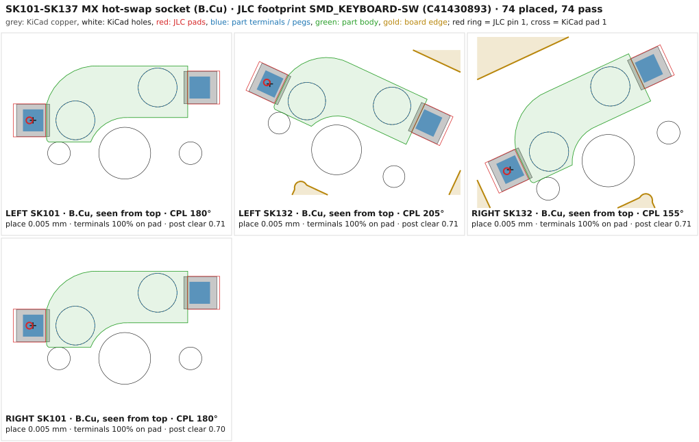
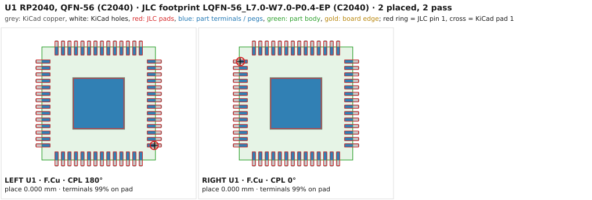

# Ordering the PCBs from JLCPCB (turnkey)

This page takes you through one turnkey order at [JLCPCB](https://jlcpcb.com) for one keyboard. JLC
makes both PCBs, buys every part, places both sides, hand-solders the display socket J3 and ships the
boards. When they arrive, nothing on the PCB is left to solder. The left and right boards are **two
separate designs**: each is its own item in one cart.

This page is for **rev B**: an SK6812MINI-E RGB LED under every switch, fitted by JLC on the bottom
side with the sockets and diodes, the display set 1.0 mm back, and 10 µF 0603 capacitors for C1–C3
([deviations REVB](deviations.md#revb-rev-b-per-key-rgb-display-setback-and-review-fixes-layout-pcb-firmware-case-docs)).
To order the same boards from PCBWay instead, follow [ordering-pcbway.md](ordering-pcbway.md): it
uses its own BOM and centroid files, never the JLC ones on this page.

The case is a separate order (JLCCNC and JLC3DP, [`case/production/`](../case/production/README.md)).
Switches, keycaps, displays, cables and screws come from other shops: see
[shopping-list.md](shopping-list.md).

> [!IMPORTANT]
> Rev B is a **four-layer** board (deviation [REVB-8](deviations.md)). The order package is checked
> in CI on every push. [verification.md](verification.md#summary) records rev A's gates G1 to G3 as
> passed; the rev B results are recorded there from the final routed boards. Order only from a commit
> whose `pcb` workflow is green. No board has been built yet. Order 2
> assembled boards per side (one spare), test them ([build guide](buildguide_en.md)), and only then
> order the case in aluminium.

## Contents

- [What you upload](#what-you-upload)
- [Before you order](#before-you-order)
- [Step by step](#step-by-step)
- [Placement preview checklist](#placement-preview-checklist)
- [If a part is out of stock](#if-a-part-is-out-of-stock)
- [Cost estimate](#cost-estimate)
- [After the order is placed](#after-the-order-is-placed)
- [When the boards arrive](#when-the-boards-arrive)
- [How the package is made and checked](#how-the-package-is-made-and-checked)

## What you upload

Everything is committed under [`pcb/production/`](../pcb/production/): one folder per side.

| JLC upload field | Left | Right | Contents |
|---|---|---|---|
| Gerber file | [`left/gerbers.zip`](../pcb/production/left/gerbers.zip) | [`right/gerbers.zip`](../pcb/production/right/gerbers.zip) | the **panel**, 198.84 × 174.75 mm: the board in a frame with rails, mouse-bite tabs, 3 fiducials per side and 4 tooling holes |
| BOM file | [`left/bom.csv`](../pcb/production/left/bom.csv) | [`right/bom.csv`](../pcb/production/right/bom.csv) | one LCSC part number on every line (SW1 and SW2 are two lines of one part); the side README gives the line count |
| CPL file | [`left/cpl.csv`](../pcb/production/left/cpl.csv) | [`right/cpl.csv`](../pcb/production/right/cpl.csv) | every placement, both sides, with JLC's rotation and centre corrections applied; the side README gives the counts |

- `worxboard-<side>-jlc-order.zip` in each folder holds the same three files plus the side's
  [README](../pcb/production/left/README.md). The README repeats the order form in short, with the
  panel facts and the part counts of the committed boards.
- Rev B places **201 parts per half** (`design.py`): 53 on the top side and 148 on the bottom, which
  are the 37 hot-swap sockets, 37 diodes, 37 SK6812MINI-E LEDs (LED101–LED137) and their 37 100 nF
  caps (C101–C137).
- `bare-board/` holds the board without a frame (182.84 × 158.75 mm), for an order where JLC adds
  the rails itself. Use it only if JLC refuses the panel. Its README gives the form changes and the
  remark to paste.
- The panel is the default. JLC's assembly terms want parts at least 2.5 mm from the board edge, or
  rails. Here J1 (USB-C) and J2 (TRRS) overhang the edge by design, and several thumb sockets sit
  closer than 2.5 mm (deviation BOARD-7). The panel's 2 mm milled slot gives them room, and it has
  no tab in front of J1 or J2.

## Before you order

1. **CI is green on the commit you order from.** The
   [`pcb` workflow](https://github.com/w0rxbend/worxboard/actions/workflows/pcb.yml) rebuilds both
   order packages from the committed boards and fails on any byte of difference ("Order package
   left/right"). It also redraws the placement overlays ("CPL overlay drawings").
2. **Stock, on the day.** Run `just pcb-stock left 5`. It checks the live JLC stock of every BOM line
   for 5 assembled boards per half, both halves together, and it needs the network. On
   2026-11-04 at 05:17 UTC every line of rev A passed. The thinnest were C95562 (TRRS jack, 5 513),
   C27985230 (J3, 6 294), C51118 (LDO, 12 075) and C49304726 (crystal, 13 833). Rev B's new parts
   (C5149201 LED, C55136 U6, C100024 U7, C19702, C25756, C25117) were not in that check; the same
   command checks them. If a line fails, see [If a part is out of stock](#if-a-part-is-out-of-stock).
3. **The files.** Download each side's `worxboard-<side>-jlc-order.zip` from GitHub (open the file
   in [`pcb/production/`](../pcb/production/), then *Download raw file*) or take them from a clone,
   then unzip them. Do not use `build/<side>/jlc/` or the CI `worxboard-pcb-<side>` artifacts: those
   are KiKit's raw bare-board files, without the panel and in KiKit's own column names.
4. A JLCPCB account with a shipping address. Optionally, run the Gerbers through
   [JLCDFM](https://dfm.jlcpcb.com) first: it shows what JLC's engineers will see.

## Step by step

Do steps 1 to 8 for the **left** side, then again for the **right** side with `pcb/production/right/`.
JLC renames form options now and then, so pick the closest match. The values are what matters.

### 1. Upload the Gerbers

On [jlcpcb.com](https://jlcpcb.com), open *Instant Quote* and upload `gerbers.zip` as the Gerber
file. JLC should read **4 layers** and **198.84 × 174.75 mm**. In the Gerber viewer the two inner
layers are nearly solid copper: inner 1 (`-inner1.g1`) is the GND plane and inner 2 (`-inner2.g2`) the
VLED plane. If it shows about 183 × 159 mm, you
uploaded the bare board.

### 2. PCB options

| Option | Value | Why |
|---|---|---|
| Base material | FR-4 | |
| Layers | **4** | F.Cu signal, In1 GND plane, In2 VLED plane, B.Cu signal (REVB-8) |
| Dimensions | 198.84 × 174.75 mm (read from the Gerbers) | the panel |
| PCB qty | **5** | the minimum; you get 5 panels, of which the PCBA quantity are assembled |
| Product type | Industrial/Consumer electronics | |
| Different design | 1 | one board per panel |
| Delivery format | **Panel by Customer** (if the form asks for the panel format: 1 column × 1 row) | the frame is in the Gerbers |
| PCB thickness | **1.6 mm** | the case stack is built on it |
| Impedance control | **No** | nothing on the board needs a controlled impedance |
| Layer stackup | **JLC04161H-7628** (JLC's default for 4 layers, 1.6 mm) | any standard 1.6 mm stack-up does |
| PCB colour | any (green is cheapest and fastest) | the mask webs at the QFN (about 0.2 mm) suit every colour |
| Silkscreen | the default for the colour | |
| Material type | FR-4 TG135 (the default) | |
| Surface finish | **ENIG** (1 U" gold) | flat pads for the 0.4 mm QFN and the USB-C |
| Outer copper weight | 1 oz | |
| Inner copper weight | **0.5 oz** (the default) | the planes carry under 0.5 A |
| Via covering | **Tented** | |
| Min via hole size / diameter | 0.3 mm / (0.4/0.45 mm), the default | every via is 0.3 / 0.6 mm |
| Board outline tolerance | ±0.2 mm (regular) | |
| Confirm production file | **Yes** | you approve the panel JLC will make |
| Mark on PCB | none: JLC adds no mark by default (its order-number option was dropped in 2026-05) | the boards carry their own label |
| Electrical test | flying probe, the default | |
| Gold fingers, castellated holes, edge plating, press-fit | No | |
| Build time | standard | JLC adds $15.71 per design for an expedited panel order |

### 3. PCB assembly options

Turn on **PCB Assembly** at the bottom of the form.

| Option | Value | Why |
|---|---|---|
| PCBA type | **Standard** | Economic places one side only; this board has 148 parts on the bottom |
| Assembly side | **Both sides** | top: the RP2040 cluster, USB-C, TRRS, J3, and the LED switch U6 and buffer U7; bottom: 37 sockets, 37 diodes, 37 LEDs and their 37 caps |
| PCBA qty | **2** | one for the keyboard and one spare; on rev A's estimate, 5 added about $27 per design ([costs](#cost-estimate)) |
| Tooling holes | **Added by Customer** | 4 non-plated Ø2.0 mm holes in the rail corners |
| Edge rails / fiducials | **Added by Customer** | rails 6 mm or wider; 3 fiducials per side, Ø1.0 mm copper in a Ø2.0 mm opening, 4.0 mm from the edges (JLC asks for 3.85 mm) |
| Confirm parts placement | **Yes** | an engineer sends you the placement for approval before production |
| Depanel / remove edge rails | No | break the tabs yourself ([below](#when-the-boards-arrive)) |
| Other advanced options | defaults | |

Paste the *Remark* from the side's README
([left](../pcb/production/left/README.md#remark), [right](../pcb/production/right/README.md#remark))
into the order's remark field. It is generated with the package, so it always matches the committed
files. It answers what JLC's engineers would otherwise ask about, and each question puts the order
on hold: the customer panel (rails, fiducials, tooling holes), J1 and J2 overhanging the board edge
on purpose, J1's four shell legs (pin-in-paste, please solder), the bottom-side parts, J3 as the only
THT part (hand solder), the two pairs of stabiliser holes under JLC's hole spacing, and shipping with
the frame attached.

The stabiliser holes: where the two 2u thumb keys meet, the Ø3.05 mm hole of one stabiliser and the
Ø4.0 mm hole of the next leave 0.28 mm of board between them, twice per half. JLC's
[capabilities](https://jlcpcb.com/capabilities/pcb-capabilities) give 0.45 mm as the pad
hole-to-hole spacing. They are non-plated clearance holes for the plate-mounted stabilisers, with no
copper near, so it does no harm if the web between them breaks (deviation ORDER-3).

### 4. Check the board views

JLC shows the top and the bottom of the Gerbers. You should see the board inside its frame, the three
copper fiducials on each side of the rails and the four holes in the rail corners. Continue.

### 5. Upload the BOM and the CPL

Upload `bom.csv` as the BOM file and `cpl.csv` as the CPL file, then *Process BOM & CPL*. The
headers are JLC's own (`Comment,Designator,Footprint,LCSC Part #` and
`Designator,Mid X,Mid Y,Layer,Rotation`), so no column mapping should be needed. If JLC asks,
map them one to one.

### 6. Check the parts list

JLC lists one line per line of `bom.csv`; the side README gives the count (SW1 and SW2 are two lines
of the same part). For each line:

- the line is **selected** (ticked) and shows the LCSC number from [bom.md](bom.md#per-half-assembled-by-jlcpcb);
- the quantity matches: 37 for the sockets, the diodes and the LEDs (C5149201), 49 for C1525 (the
  100 nF caps, the 37 LED caps among them);
- there is no *shortage* and no *No Part Selected*.

Rev B adds three **extended** parts: C5149201 (SK6812MINI-E, LED101–LED137), C55136 (SY6280AAC, U6)
and C100024 (SN74LV1T34DBVR, U7). C1–C3 and C20 are the 0603 10 µF C19702 (basic); rev A's 0402
C15525 must not appear.

J3 (C27985230) is the only through-hole part. JLC hand-solders it, and the quote carries a
hand-soldering fee for it. Every other part is SMT. J1's four shell legs go through slots in the
board, but the paste layer opens those slots, so they reflow with J1's SMT pins (pin-in-paste) and
need no hand-soldering; the remark asks for them in any case. The library type (basic or extended)
does not change the price in Standard PCBA: every part pays the same loading fee, so the new extended
parts add only their loading fee and their unit price.

### 7. Check the placement preview

JLC draws its own footprint of each part where the CPL puts it. Work through the
[checklist below](#placement-preview-checklist), on the top and then on the bottom side. Do not
move or rotate anything in the viewer unless a part is clearly wrong. If one is, write the
designator and what you saw in the remark: the engineer checks it at *Confirm parts placement*.

### 8. Product description, then add to cart

On the *Quote & Order* page, choose the product description that fits a keyboard PCB assembly,
such as an entry for computer peripherals or keyboards. JLC uses it for the customs declaration. Its
[tariff FAQ](https://jlcpcb.com/help/article/us-tariff-policy-faq) (updated 2026-10-29) lists HS
847330, "computer parts and accessories", for PCBA orders, which it calls intermediate products, and
JLC may change the code to match the goods. Save the item to the cart.

Repeat steps 1 to 8 for the right side.

### 9. Check out

In the cart, check both items: two designs, each 5 PCBs and 2 assembled, Standard, both sides.
Choose a shipping method. Shipments to individuals in the US go DDP: JLC collects the duties up
front. Then pay.

## Placement preview checklist

Every placement in `cpl.csv` is checked against JLC's own footprint of that part: KiKit places it
where the CPL says, and `pcb/scripts/cpl_check.py` compares it with the KiCad pads. Stage P fails if
one placement does not pass; the side README and [verification.md](verification.md) give the count.
The reverse-mount LEDs are held to 55 % of each terminal on its pad instead of the usual 75 %,
because JLC's leads start 0.15 mm over the cutout (deviation REVB-1). Each drawing below shows JLC's
footprint, placed from the CPL, over the KiCad pads. Bottom-side parts are drawn as seen through the
board from the top. **The drawings are rev A's**: the rev B part types (the LEDs, the 0603
capacitors, U6 and U7) are drawn when the boards are regenerated (`just pcb-cpl-images`). What the
preview still has to confirm is how JLC's own viewer applies the CPL, the bottom side above all.
JLC does not document its bottom-side convention, and the CPL follows the one that KiKit,
kicad-jlcpcb-tools and KiBot use.

**Top side**

| Part | Check in the preview | Drawing |
|---|---|---|
| U1, RP2040 (QFN-56) | the chip's pin-1 dot sits at the pin-1 corner of the silkscreen. The left U1 is turned 180° from the right one on purpose (CPL 180° left, 0° right) | [cpl-u1-rp2040-qfn56.svg](images/cpl-u1-rp2040-qfn56.svg) |
| U2, flash (SOIC-8) | the pin-1 dot or bevel at pad 1 | [cpl-u2-flash-soic8.svg](images/cpl-u2-flash-soic8.svg) |
| U3, LDO (SOT-23-5) | three leads on the three-pad side, two on the two-pad side | [cpl-u3-ldo-sot23-5.svg](images/cpl-u3-ldo-sot23-5.svg) |
| U6, LED power switch SY6280AAC (SOT-23-5, rev B) | as U3: three leads on the three-pad side, pin 1 on pad 1 | after regeneration |
| U7, LED data buffer SN74LV1T34 (SOT-23-5, rev B) | three leads on the three-pad side, pin 1 on pad 1. U7 takes its own correction (`JLCPCB_CORRECTION` 0;0;180), because JLC's footprint of C100024 has pin 1 in the other corner from the SOT-23-5 row's parts: check its pin-1 mark on its own | after regeneration |
| U4, U5, ESD (SOT-23-6) | the pin-1 mark at pad 1. The left U4 sits at an angle (61.46°) | [cpl-u4-u5-esd-sot23-6.svg](images/cpl-u4-u5-esd-sot23-6.svg) |
| Y1, crystal (3225) | the pin-1 corner mark at pad 1 | [cpl-y1-crystal-3225.svg](images/cpl-y1-crystal-3225.svg) |
| J1, USB-C | the **mouth faces out over the back edge**, the two plastic pegs sit in the two small holes, and the four shell legs sit in their slots | [cpl-j1-usb-c.svg](images/cpl-j1-usb-c.svg) |
| J2, TRRS jack | the **barrel mouth is at the bump edge**, pointing out of the board, with the two pegs in their holes | [cpl-j2-trrs-pj320d.svg](images/cpl-j2-trrs-pj320d.svg) |
| J3, display socket (THT) | the body lies along the row of five holes, one contact per hole | [cpl-j3-display-socket.svg](images/cpl-j3-display-socket.svg) |
| D1, Schottky (SOD-123) | the cathode band at pad 1 (the VSYS side) | [cpl-d1-schottky-sod123.svg](images/cpl-d1-schottky-sod123.svg) |
| SW1, SW2, F1, 0402 R and C, 0603 C (C1–C3, C20) | on their pads | [tact](images/cpl-sw-tact-ts1088.svg), [PTC](images/cpl-f1-ptc-1206.svg), [R](images/cpl-r-0402.svg), [C](images/cpl-c-0402.svg) |

**Bottom side**

| Part | Check in the preview | Drawing |
|---|---|---|
| SK101–SK137, hot-swap sockets | the socket's curved **notch wraps the big round switch-centre hole**, and its two metal terminals sit on the two pads. A socket turned 180° still covers both pads, but its body then sits over the centre hole. The thumb sockets SK132–SK137 sit at 155° or 205° | [cpl-sk-hotswap-socket.svg](images/cpl-sk-hotswap-socket.svg) |
| D101–D137, diodes (SOD-123F) | the **cathode band at pad 1**, the ROW side. Rev B moved them to 8.5 mm below the switch centre, below the LED | [cpl-d101-diode-sod123f.svg](images/cpl-d101-diode-sod123f.svg) |
| LED101–LED137, SK6812MINI-E (reverse mount, rev B) | each LED's body over the **small rectangular cutout** 5.08 mm below its switch centre, its four leads on the four pads, JLC's pin-1 mark on pad 1. The LEDs are turned along the serpentine chain, so they face opposite ways from row to row; the thumb LEDs follow the 25° cluster | after regeneration |
| C101–C137, LED caps (0402, rev B) | each beside its LED, on its pads | [C](images/cpl-c-0402.svg) (rev A drawing) |

> [!WARNING]
> JLC's viewer could read the bottom side another way than KiKit. The **thumb parts** tell. A part
> at 0° or 180° looks the same whichever way the viewer turns it, and so does a two-pad cap at 90°
> or 270°: every bottom part of the main block is one of those (rev B's LEDs alternate between 0°
> and 180° along the chain, their caps sit at 90° or 270°). Only the thumb parts sit at other
> angles: the sockets SK132–SK137 and diodes D132–D137 at 205° (left) or 155° (right), and in rev B
> the thumb LEDs and their caps. The side README lists those parts with their CPL angles.
>
> - **Only the thumb parts look turned** (the sockets and diodes by about 50°, the sockets several
>   mm off their pads), and everything else looks right: the viewer turns bottom parts the other way
>   round. The thumb parts then need 360° minus the CPL value: **155° on the left, 205° on the
>   right** for the sockets and diodes.
> - **Every socket, diode and LED on the bottom looks turned by 180°:** the viewer mirrors bottom
>   parts about the other axis.
>
> In either case, do not edit the files. Ask for the correction in the placement confirmation,
> with the designators and the rotation they need (deviation ORDER-2).

## If a part is out of stock

Run `just pcb-stock left 5` again on the day: it names the line that fails. Then, in this order:

1. **Swap on JLC's parts page, only to a pre-checked alternate.** Click the part's search or
   replace button and enter the alternate's LCSC number. JLC places by designator from the same
   CPL, and the alternates marked "yes" below have JLC footprints that take the same correction as
   the original. `cpl_check.py` checked them (`pcb/scripts/jlc_footprints.json`).
2. **Any other alternate** must have the same package, value and pinout. Check it in the placement
   preview with extra care, because its JLC footprint may have another origin or zero angle. For
   the next order, put it in `pcb/scripts/design.py` and rebuild the package, so that
   `cpl_check.py` proves it.
3. **Do not untick a part** to order without it, unless you accept soldering it yourself.

| Ref | Part | Alternate | Stock 2026-11-04 | Placement checked | Notes |
|---|---|---|---|---|---|
| SK101–SK137 | C41430893 | **C49352235** (HanElectricity CPG151101S11-2) | 26 943 | yes, same row | its body clears the switch post by 0.50 mm at 180° |
| Y1 | C49304726 | **C9002** (YXC X322512MSB4SI, basic) | 286 104 | yes, no row | CL 20 pF against the 18 pF the 27 pF caps give: a few tens of ppm, far inside USB's ±2500 ppm (ELEC-1) |
| J3 | C27985230 | **none that fits the case** | | | the 5.7 mm sockets (C46061764, C55218875) take the same row but lift the glass 0.7 mm, to 10.45 mm above the PCB at full tolerance, over the pocket ceiling at 10.0 mm (CASE-1). If J3 is out, wait for stock, or untick J3 and solder the 5 mm socket that ships with the nice!view yourself |
| U3 | C51118 | C82942 (ME6211C33M5G-N) | 370 432 | no | same SOT-23-5 pinout (1 VIN, 2 GND, 3 EN, 4 NC, 5 VOUT; both datasheets), 500 mA |
| U4, U5 | C7519 | C2687116 (UMW USBLC6-2SC6) | 109 130 | no | a second-source copy of the same part |
| F1 | C70076 | none checked | | | REVB-9: nSMD050-24V, 500 mA hold. If it is out, pick a 1206 PTC with 500 mA hold and 24 V or more and check its footprint; do not go back to a 250 mA part (C70069, C70070) |
| R3, R4 | C2909343 | C25100 (27 Ω 0402) | 36 392 | no | any 27 Ω 0402 |
| other R and C (0402; 0603 for the 10 µF C1–C3, C20) | | any part of the same value, package and dielectric (prefer basic parts) | | no | keep the 10 µF at 0603, 10 V or more: rev A's 0402 6.3 V part kept only about 2–3 µF at VSYS (REVB-3) |
| U1, U2, J1, J2, SW1, SW2, D1, D101–D137, U6, U7, LED101–LED137 | | no alternate checked | | | U1 has one source. U2 has huge stock (74 052) as a basic part. For J1 and J2 any other part needs another footprint, so wait for stock. U7's correction (0;0;180) belongs to JLC's footprint of C100024, and the LEDs need a reverse-mount part for the cutout: an alternate for either needs its own placement check |

The retired parts C2803348 (the Kailh socket), C113767 (the old flash), C91749 (the old crystal)
and C15525 (rev A's 0402 6.3 V 10 µF) must not come back: `stock.py` and `netcmp.py` fail on
them.

## Cost estimate

> [!NOTE]
> This is **rev A's** estimate, and rev B has not been re-estimated: **read the cost from your
> quote.** Rev B is a four-layer board (REVB-8), which costs more to fabricate than the two-layer
> line below. It also costs more on every assembly line that counts parts: it places 82 more parts per half (the 74 LEDs and caps on the
> bottom, 8 parts on top), so more SMT joints and more parts to buy (37 LEDs per board among them),
> and it has five more unique part numbers, so the part loading adds 5 × $1.53 per design. Setup,
> stencil, X-ray and the J3 hand soldering do not change. Your cart shows the real figures.

Estimated on **2026-11-04**, for one keyboard: two designs, each with 5 PCBs and 2 assembled. The
assembly rates are from JLC's [PCBA price page](https://jlcpcb.com/help/article/pcb-assembly-price)
(last updated 2026-10-22). Part prices are JLC's live unit prices for the quantity JLC buys, which
is 2 boards plus its attrition, read at 05:15 UTC. JLC publishes no price formula for the bare PCB
or for shipping, so those two lines are ranges, not quotes. Your cart shows the real figures.

| Line | Per design | Both designs | Basis |
|---|---|---|---|
| PCB fabrication, 5 panels, ENIG | $20–50 (rev A, 2 layers) | $40–100 (rev A, 2 layers) | not quoted, and rev B's 4 layers cost more: read it from the quote. The panel is 347 cm², under JLC's 650 cm² large-size limit |
| Setup, Standard, double-sided | $51.12 | $102.24 | price page |
| Stencil, double-sided | $16.42 | $32.84 | price page |
| Part loading, 20 SMT part numbers × $1.53 | $30.60 | $61.20 | the same for basic and extended parts in Standard PCBA. JLC does not say whether the THT J3 counts: +$1.53 if it does |
| SMT joints, 330 per board × 2 × $0.0016 | $1.06 | $2.12 | 335 joints per board, less J3's 5 |
| THT hand soldering, J3: $3.58 per order + 10 joints × $0.0164 | $3.74 | $7.48 | price page |
| X-ray for the QFN, 2 × $1.64 | $3.28 | $6.56 | the price page lists X-ray as required for QFN |
| Parts for 2 boards, with attrition | $16.17 | $32.34 | the largest lines: U2 $4.92, sockets $3.42, U1 $2.18 |
| Confirm parts placement | $0.45 | $0.90 | price page |
| Packing | $0.52 | $1.04 | $0.50 + $0.00003 per cm² |
| **PCBA subtotal** | **$123.36** | **$246.72** | |
| Fixtures, if charged: 2 × $8.21 | $0–16.42 | $0–32.84 | listed on the price page without a condition |
| Shipping | | $20–45 | not quoted. It depends on the country and the carrier |
| **Total** | | **about $307–425** | before import duty and VAT |

- **Extended-part fees:** none apply. JLC's separate fee per extended part ($3.07) is for Economic
  PCBA only, which this board cannot use.
- **5 assembled per side** instead of 2 adds about $27 per design: parts $35.90, X-ray $8.20, joints.
- No panel fee: JLC charges it only when one panel holds more than one design.
- The case is quoted by JLCCNC and JLC3DP when you upload the files
  ([`case/production/`](../case/production/README.md)). The off-board parts are in
  [shopping-list.md](shopping-list.md).

## After the order is placed

JLC's engineers review the files after payment. A question puts the order on hold until you answer
it in the order page.

- **Confirm production file.** JLC posts the panel as it will be made. Check that it is the
  198.84 × 174.75 mm panel from the Gerbers: no extra holes inside the board outline (the 37 small
  rectangular LED cutouts per half belong there), no V-cut, and no tab in front of J1 (back edge) or
  J2 (bump edge). Then approve it.
- **Confirm parts placement.** JLC posts the placement on both sides. Work through the
  [checklist](#placement-preview-checklist) again, then approve.

Likely questions and the answers:

| Question | Answer |
|---|---|
| Parts closer than 2.5 mm to the board edge (J1, J2, thumb sockets) | Intended. J1 and J2 overhang the edge into the 2 mm milled slot of the customer panel. The rails are on the frame. |
| J1 or J2 overhangs the board outline | Intended: the connector mouths are the case openings. |
| Tooling holes are 2.0 mm, not 1.152 mm | They follow JLC's SMT guideline of 2026-09. Add your own on the rails if you need them, but none inside the board. |
| J1's four shell legs are through-hole slots: solder them? | Yes. The paste layer opens them for pin-in-paste, so they reflow with the SMT parts. If the stencil cannot carry them, solder them by hand: they hold the receptacle and tie its shield to GND. |
| Bottom-side rotation of the sockets, diodes or LEDs | As the CPL gives it: each socket's notch wraps the round switch-centre hole, each diode's cathode band is at pad 1, and each LED's pin 1 is on pad 1 with its body over its cutout. |
| LED101–LED137 sit over board cutouts: reverse mount? | Yes. They are SK6812MINI-E reverse-mount LEDs (C5149201), placed on the bottom side with the body in the 3.4 × 3.0 mm cutout and the lens facing up through the board. |
| Copper close to the small rectangular cutouts | Intended: the 37 LED cutouts per half are part of the LED footprint, and copper keeps at least 0.3 mm from them (the board outline keeps 0.5 mm). |
| Silkscreen over pads or past the edge | Clip it. |
| J3 is through-hole | Yes: C27985230, hand-soldered from the top, 5 joints. |
| Hole-to-hole spacing under 0.45 mm (STAB_T4 / STAB_T5) | Intended: non-plated stabiliser clearance holes, no copper near. They may break into each other. |

## When the boards arrive

1. Break each board out of its frame at the mouse-bite tabs. Bend each tab gently, away from
   J1 and J2: those two overhang the edge.
2. File or sand every tab nub flush with the board edge. The case leaves only about 0.3 mm round
   the PCB.
3. Keep the spare assembled board and the three bare panels per side.
4. Continue with the [build guide](buildguide_en.md): check the boards (each LED in its cutout,
   flat and not tilted), flash and test them, all 37 LEDs per half included, before the case goes
   on.

## How the package is made and checked

| Command | What it does |
|---|---|
| `just pcb-production <side>` | builds `pcb/production/<side>/` from the committed board: KiKit panel (`pcb/scripts/panel.json`, `panel_tabs.py`), Gerbers, BOM and CPL in JLC's formats, README, order zip, bare-board files, and the PCBWay files in `pcbway/` ([ordering-pcbway.md](ordering-pcbway.md)) |
| `just pcb-production-check <side>` | rebuilds and requires the committed package to match byte for byte. CI's "Order package" jobs run this |
| `just pcb-stock <side> [boards]` | `jlc_check.py`: formats, BOM = CPL = the parts `design.py` fits (201 per half in rev B), panel size, rails, fiducials, tooling holes, plus live JLC stock |
| `just pcb-cpl-images` | redraws `docs/images/cpl-*.svg` with `cpl_check.py` (CI's "CPL overlay drawings" job) |
| `just pcb-fab <side>` | stage D: the board's own fab outputs, with `netcmp.py --board` (the parts, LCSC numbers and J3's pin-1 end) and `cpl_check.py` |

The CPL corrections live in `pcb/scripts/jlc_rotations.csv`. KiKit applies them by footprint
name, unless the part carries its own `JLCPCB_CORRECTION` field, which KiKit takes first. A
bottom-side part gets 180° minus the KiCad angle plus the correction, with the X and Y offset not
mirrored:

| Footprint | Parts | X; Y; rotation |
|---|---|---|
| `QFN-56-1EP_7x7mm_P0.4mm_EP3.2x3.2mm` | U1 | 0; 0; 0 |
| `SOIC-8_5.3x5.3mm_P1.27mm` | U2 | 0; 0; 270 |
| `SOT-23-5`, `SOT-23-6` | U3, U6, U4, U5 | 0; 0; −90 |
| `SOT-23-5`, per-part `JLCPCB_CORRECTION` field (rev B) | U7 (C100024) | 0; 0; 180: JLC's footprint of C100024 has pin 1 in the other corner from the SOT-23-5 row |
| `USB_C_Receptacle_HRO_TYPE-C-31-M-12` | J1 | 0; −1.394; 0 |
| `Jack_3.5mm_PJ320D_Horizontal` | J2 | 0.776; 0; 90 |
| `worxboard:SW_MX_Hotswap_Kailh` | SK101–SK137 | 0.635; 3.81; 180 |
| `worxboard:PinSocket_1x05_P2.54mm_Vertical_H5.0mm` | J3 | 0; 5.08; 270 |
| `worxboard:LED_SK6812MINI-E_ReverseMount` (rev B) | LED101–LED137 | no correction |
| everything else (0402 R and C, 0603 C, SOD-123, SOD-123F, 3225 crystal, TS-1088, 1206) | | no correction |

Each row was derived from JLC's footprint of that LCSC part, which is fetched by
`pcb/scripts/jlc_footprints.py` from the EasyEDA / JLCEDA library. Each row is proven by
`cpl_check.py`, which also fails the wrong values: U1 at 270° lands 6.1 mm off, and a socket at 0°
puts its body 1.13 mm into the switch's centre-post hole. Deviations PKG-1 to PKG-4 have the details,
and REVB-1 those of U7 and the LEDs. The PCBWay files carry none of these corrections: they are
KiCad's own centroids, so the JLC `cpl.csv` must never go to PCBWay.
